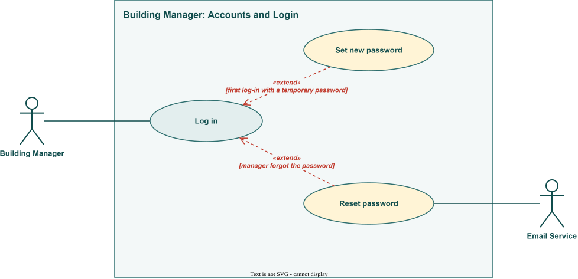
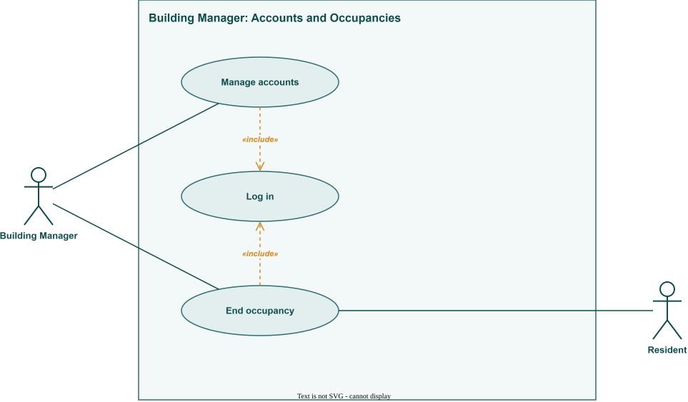
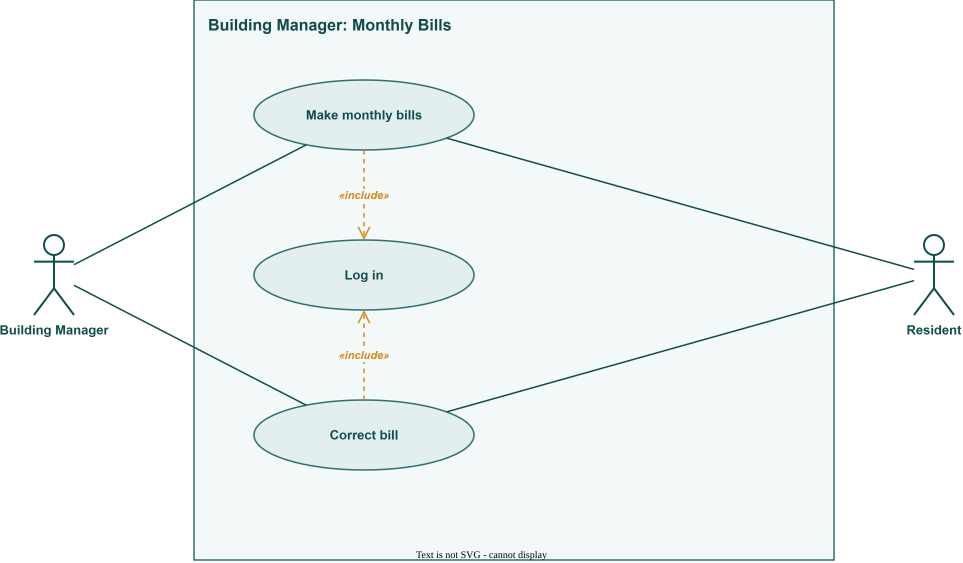
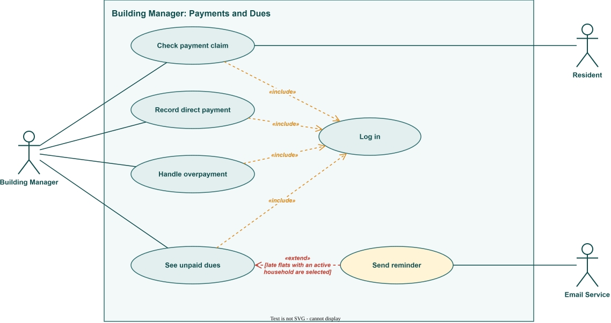
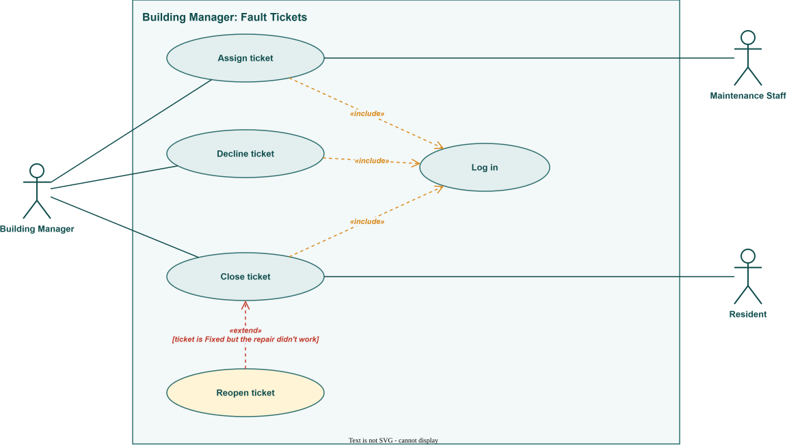
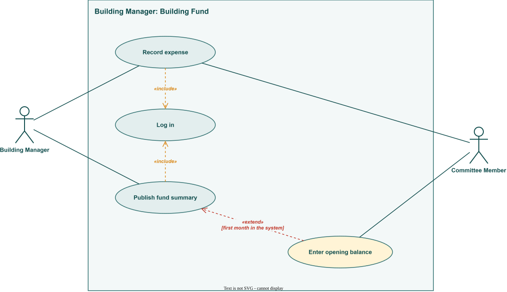
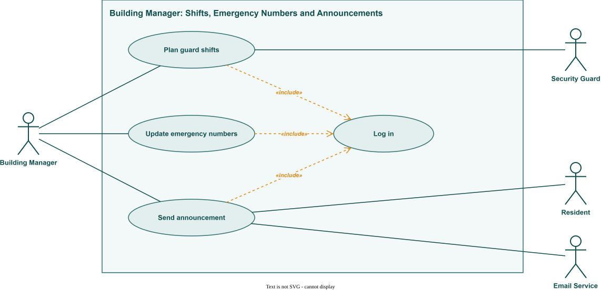
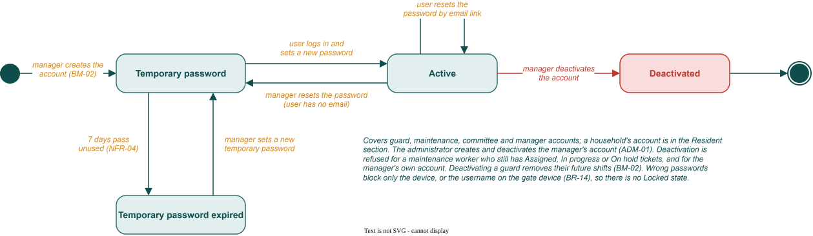
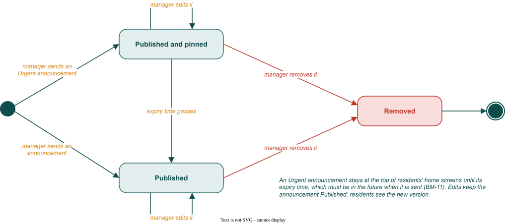
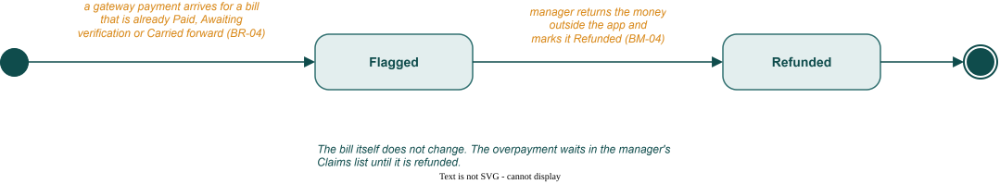

# Building Manager: use cases and state diagrams

This part covers the Building Manager user class of BariBondhu (Apartment Building Management System). Story IDs (BM), business rules (BR) and non-functional requirements (NFR) refer to the SRS.

The diagrams are `.drawio.svg` files in `diagrams/building-manager/use_case/` and `diagrams/building-manager/state_diagrams/`. To edit one, open it in draw.io or the VS Code Draw.io Integration extension. The administrator who creates the manager's account is covered in [System_Administrator_SDS.md](../system-administrator/System_Administrator_SDS.md). The system's data flow diagram is in [Data_Flow_Diagrams.md](../system/Data_Flow_Diagrams.md).

## 1. UML use case diagrams

The Building Manager is the primary actor. Residents, security guards, maintenance staff, committee members and the Email Service join in as secondary actors. There are seven diagrams, one per subsystem. Apart from Reset password, every use case needs the manager to be logged in, which the diagrams show as «include» Log in. The condition for each «extend» is written on its arrow.

*Figure B1: Building Manager use cases: Accounts and Login*

*Figure B2: Building Manager use cases: Accounts and Occupancies*

*Figure B3: Building Manager use cases: Monthly Bills*

*Figure B4: Building Manager use cases: Payments and Dues*

*Figure B5: Building Manager use cases: Fault Tickets*

*Figure B6: Building Manager use cases: Building Fund*

*Figure B7: Building Manager use cases: Shifts, Emergency Numbers and Announcements*

## 2. Use case narratives

Each use case has its own narrative in the Lecture 3 table format. An alternate flow is numbered after the step it branches from, so 2a branches from step 2.

### UC-BM01 Log in

| Field | Description |
|---|---|
| **Use case** | UC-BM01 Log in (BM-01) |
| **Actors** | Primary: Building Manager |
| **Precondition** | The administrator has created the manager account (ADM-01) and the account is active. |
| **Trigger** | The manager opens BariBondhu while logged out. |
| **Main success scenario** | 1. Manager enters the username and password. 2. System checks them and checks that the account is active. 3. System opens the manager dashboard. |
| **Alternate flows** | 1a. Manager taps Forgot password → «extend» Reset password (UC-BM03). 2a. First log-in with a temporary password → «extend» Set new password (UC-BM02), then step 3. 2b. Wrong username or password → error shown, return to step 1. After 5 wrong passwords in a row, this device must wait 15 minutes and the screen shows the time left (BR-14). 2c. The account has been deactivated → log-in refused. Past records stay (BM-02). 3a. A resident, guard, maintenance or committee user tries to open a manager page → access refused. |
| **Postcondition** | The manager is logged in and can use only the manager pages. |
| **Non-functional** | HTTPS only (NFR-03). Passwords stored only as salted hashes (NFR-04). Wrong-password limit (NFR-05, BR-14). Session ends after 7 days idle (NFR-07). Every page checks the role (NFR-06). |

### UC-BM02 Set new password

| Field | Description |
|---|---|
| **Use case** | UC-BM02 Set new password (BM-01, BR-15) |
| **Actors** | Primary: Building Manager |
| **Precondition** | The account has a temporary password that is less than 7 days old. |
| **Trigger** | The user logs in with the temporary password (extends Log in at step 2). |
| **Main success scenario** | 1. System asks for a new password. 2. Manager enters the new password twice. 3. System checks that it has at least 8 characters and that both entries match. 4. System saves the password and Log in continues at step 3. |
| **Alternate flows** | 3a. Too short, or the two entries differ → System says what is wrong, return to step 2. Temporary password older than 7 days → log-in refused, and the manager is told to ask the administrator for a new one. |
| **Postcondition** | The temporary password no longer works. The account is Active. |
| **Non-functional** | At least 8 characters, stored only as a salted hash, never sent by email (NFR-04). |

### UC-BM03 Reset password

| Field | Description |
|---|---|
| **Use case** | UC-BM03 Reset password (BM-01, BR-15) |
| **Actors** | Primary: Building Manager · Secondary: Email Service |
| **Precondition** | The manager is not logged in. |
| **Trigger** | The user taps Forgot password on the log-in screen (extends Log in at step 1). |
| **Main success scenario** | 1. User enters the username. 2. System finds the email address on the account. 3. System sends a reset link, valid for 30 minutes, through the Email Service. 4. User opens the link and enters a new password of at least 8 characters. 5. System saves the password and the manager logs in (UC-BM01). |
| **Alternate flows** | 2a. The account has no email address → the screen tells the manager to ask the administrator for a new temporary password. The use case ends. 4a. The link is older than 30 minutes or was already used → "This link has expired", return to step 1. |
| **Postcondition** | The new password works and the old one does not. |
| **Non-functional** | The reset link expires after 30 minutes. The password itself is never emailed (NFR-04). |

### UC-BM04 Manage accounts

| Field | Description |
|---|---|
| **Use case** | UC-BM04 Manage accounts (BM-02) |
| **Actors** | Primary: Building Manager · Secondary: Resident, Security Guard, Maintenance Staff, Committee Member (the account owners) |
| **Precondition** | The manager is logged in («include» Log in). |
| **Trigger** | The manager opens Accounts and taps Add, or opens an existing account. |
| **Main success scenario** | 1. Manager chooses the kind of account: household (for a flat), guard, maintenance or committee. 2. Manager enters the details. For a household: the flat, occupant name, owner or tenant, start date, phone and an optional email. For staff and committee: name, phone, role and an optional email. 3. System checks the details. 4. System creates the account with a generated username (not the flat number) and a temporary password, and shows it in the list. |
| **Alternate flows** | 2a. The flat already has an active occupancy → "End the current occupancy first". Nothing is created. 1a. Manager edits a phone number, email or flat details → the new details show straight away and the change is logged. 1b. A user forgot the password and has no email → manager issues a new temporary password, which must be changed at the next log-in. 1c. Manager deactivates a guard, maintenance or committee account → that person can no longer log in. Their tickets and committee decisions are kept. A household account ends only through End occupancy (UC-BM05). 1c-i. The account is a maintenance worker with Assigned, In progress or On hold tickets → "Reassign their open tickets first". Nothing changes. 1c-ii. The account is a guard → their future shifts are removed and the gaps show in the duty list (BM-09). 1c-iii. The account is the manager's own → refused. Only the administrator can replace the manager (ADM-01). |
| **Postcondition** | The account is created, changed or deactivated, and the change is logged. |
| **Non-functional** | Usernames are generated, never the flat number (NFR-05). Temporary passwords expire after 7 days (NFR-04). Phone numbers are shown only to the manager and the household (NFR-10). Every change is logged (NFR-27). |

### UC-BM05 End occupancy

| Field | Description |
|---|---|
| **Use case** | UC-BM05 End occupancy (BM-02, BR-05, BR-09) |
| **Actors** | Primary: Building Manager · Secondary: Resident |
| **Precondition** | The manager is logged in («include» Log in). The flat has an active occupancy. |
| **Trigger** | A household moves out, and the manager opens the flat and taps End occupancy. |
| **Main success scenario** | 1. Manager enters the move-out date. 2. System checks that no bill of the household is Payment pending or Awaiting verification. 3. If the household still has Unpaid bills, the manager writes how they will be settled. 4. System ends the occupancy, deactivates the household account, cancels its guest passes and keeps all its records. 5. The flat is ready for a new occupancy with an empty history. |
| **Alternate flows** | 2a. A payment is in progress → "Settle the payment in progress first". Nothing changes. 3a. No Unpaid bills → step 3 is skipped. |
| **Postcondition** | The occupancy is Ended. The old household can't log in, and the next household never sees its records (BR-09). Its Unpaid bills stay Unpaid and are never carried onto the next household's bill (BR-05). |
| **Non-functional** | A new occupancy can't see any record of an earlier one (NFR-13). The change is logged (NFR-27). |

### UC-BM06 Make monthly bills

| Field | Description |
|---|---|
| **Use case** | UC-BM06 Make monthly bills (BM-03, BR-05) |
| **Actors** | Primary: Building Manager · Secondary: Resident |
| **Precondition** | The manager is logged in («include» Log in). |
| **Trigger** | The manager opens Bills and chooses a month. |
| **Main success scenario** | 1. Manager chooses the month and a due date. 2. System checks that the committee has set charge rates and that the due date is not before the first day of the month. 3. System makes one bill for every flat, occupied or vacant, with each charge (service, generator, water) and its rate. 4. An earlier Unpaid bill of the same occupancy is closed as Carried forward, and its amount appears as one Carried forward line on the new bill (BR-05). 5. System notifies each household in the app and by email. Residents see the same total and due date. |
| **Alternate flows** | 1a. Bills for the month already exist → "Bills for this month already exist". Nothing is created. 2a. No charge rates have been set → "Ask the committee to set the charge rates first". Nothing is created. 2b. The due date is before the month → "Check the due date". Nothing is created. 3a. A vacant flat's bill belongs to the flat. Only the manager sees it, and the owner pays the manager (BR-09). 3b. The committee saves a new rate during the run → the run finishes with the rates it started with (CM-01). |
| **Postcondition** | Every flat has one bill for the month, and each household owes on one open bill. |
| **Non-functional** | Totals always equal the saved records, and each carried-forward amount is counted once (NFR-26). Each bill is logged (NFR-27). Notifications within 1 minute (NFR-29). |

### UC-BM07 Correct bill

| Field | Description |
|---|---|
| **Use case** | UC-BM07 Correct bill (BM-03, BR-07) |
| **Actors** | Primary: Building Manager · Secondary: Resident |
| **Precondition** | The manager is logged in («include» Log in). The bill exists. |
| **Trigger** | The manager opens a bill and taps Correct. |
| **Main success scenario** | 1. System shows the bill with its lines and status. 2. The bill is Unpaid, so the manager changes a line and writes the reason. 3. System saves the correction and notifies the resident. |
| **Alternate flows** | 2a. No reason is written → the System asks for one and nothing changes. 2b. The bill is Paid → it can't be edited. The manager adds an adjustment line, positive or negative, with a reason to next month's bill. 2c. The bill is Payment pending or Awaiting verification → Correct isn't offered until the payment is decided. 3a. The correction brings the total to ৳0 → the bill becomes Paid with no payment. Below ৳0 → the bill becomes Paid and the difference appears as a credit line on the household's next bill. For an ended occupancy the manager refunds it outside the app (BR-07). Any attempt to delete a bill → refused. |
| **Postcondition** | The bill is corrected with a reason. Bills are never deleted. |
| **Non-functional** | A bill becomes Paid only as BR-02 allows (NFR-15). Totals equal the saved records (NFR-26). Logged with old and new values (NFR-27). |

### UC-BM08 Check payment claim

| Field | Description |
|---|---|
| **Use case** | UC-BM08 Check payment claim (BM-04, BR-05) |
| **Actors** | Primary: Building Manager · Secondary: Resident |
| **Precondition** | The manager is logged in («include» Log in). A resident has recorded a cash or bank payment, and the bill is Awaiting verification (RES-04). |
| **Trigger** | The manager opens Claims. |
| **Main success scenario** | 1. System lists the claims with the flat, amount, date, method and slip photo. 2. Manager opens a claim and checks it against the cash or the bank record. 3. Manager accepts the claim. 4. System sets the claim to Accepted and the bill to Paid, makes a receipt available and notifies the resident. |
| **Alternate flows** | 3a. Manager rejects the claim and writes a reason → the claim is Rejected, the bill returns to Unpaid and the resident sees the reason. If a newer bill exists and is still Unpaid, the amount moves onto it as a Carried forward line; otherwise the old bill stays Unpaid and can be paid on its own (BR-05). 3b. Manager rejects without a reason → "Write a reason". Nothing changes. |
| **Postcondition** | The claim is Accepted (bill Paid) or Rejected (bill Unpaid). Both are final. |
| **Non-functional** | A bill becomes Paid only on gateway confirmation or the manager's decision (BR-02, NFR-15). Slip photos are seen only by the manager and the flat (NFR-14). At most 4 taps (NFR-24). Logged (NFR-27). |

### UC-BM09 Record direct payment

| Field | Description |
|---|---|
| **Use case** | UC-BM09 Record direct payment (BM-04, BR-03, BR-06) |
| **Actors** | Primary: Building Manager |
| **Precondition** | The manager is logged in («include» Log in). A flat paid the manager in cash or by bank without recording it in the app. |
| **Trigger** | The manager opens the flat's bill and taps Record payment. |
| **Main success scenario** | 1. Manager enters the amount, date and method. 2. System checks that the bill is Unpaid and that the amount equals the bill total. 3. System sets the bill to Paid and makes a receipt available to the flat. |
| **Alternate flows** | 2a. The amount is not the bill total → "The amount must match the bill total (৳ total). Partial payments aren't supported." Nothing is saved (BR-06). 2b. The bill is Payment pending or Awaiting verification → "This bill already has a payment in progress". Nothing is saved. For a claim, the manager decides it instead (UC-BM08) (BR-03). |
| **Postcondition** | The bill is Paid with a receipt. |
| **Non-functional** | No double payment (BR-03, NFR-15). Each payment is counted once (NFR-26). Logged (NFR-27). |

### UC-BM10 Handle overpayment

| Field | Description |
|---|---|
| **Use case** | UC-BM10 Handle overpayment (BM-04, BR-04) |
| **Actors** | Primary: Building Manager |
| **Precondition** | The manager is logged in («include» Log in). A gateway confirmation arrived for a bill that was already Paid, Awaiting verification or Carried forward, so the payment was flagged as an overpayment. |
| **Trigger** | The manager opens Claims and sees the flagged overpayment. |
| **Main success scenario** | 1. System shows the flat, the bill, the amount, the gateway's transaction ID and why it was flagged. 2. Manager returns the money to the household outside the app. 3. Manager marks the overpayment Refunded. 4. System saves who marked it and when. |
| **Alternate flows** | 1a. The bill was Awaiting verification → the manager also decides the waiting claim (UC-BM08), with the online payment in view. |
| **Postcondition** | The overpayment is Refunded. The bill itself never changed. |
| **Non-functional** | No confirmed payment is lost (NFR-20). Logged (NFR-27). |

### UC-BM11 See unpaid dues

| Field | Description |
|---|---|
| **Use case** | UC-BM11 See unpaid dues (BM-05, BR-08) |
| **Actors** | Primary: Building Manager |
| **Precondition** | The manager is logged in («include» Log in). |
| **Trigger** | The manager opens Defaulters. |
| **Main success scenario** | 1. System finds every flat with an Unpaid bill past its due date (BR-08). 2. System lists each flat with the amount and how many days late it is. 3. Manager reads the list. |
| **Alternate flows** | 1a. A bill is Awaiting verification or Payment pending → that flat is not listed until it is decided. 2a. A late bill belongs to an ended occupancy or a vacant flat → it is listed and marked, but no reminder can be sent. The manager follows it up outside the app, and the flat's current household is never reminded of it (BR-09). 3a. Manager selects late flats → «extend» Send reminder (UC-BM12). |
| **Postcondition** | Nothing changes. |
| **Non-functional** | Loads within 3 s for 95% of requests (NFR-01). Totals equal the saved records (NFR-26). |

### UC-BM12 Send reminder

| Field | Description |
|---|---|
| **Use case** | UC-BM12 Send reminder (BM-05) |
| **Actors** | Primary: Building Manager · Secondary: Email Service |
| **Precondition** | The Defaulters list is open, and at least one late flat with an active household is selected. |
| **Trigger** | The manager taps Send reminder (extends See unpaid dues at step 3). |
| **Main success scenario** | 1. Manager selects one or more late flats. 2. Manager taps Send reminder. 3. System sends each household an in-app and email reminder that opens the bill (RES-01). |
| **Alternate flows** | 1a. No flat is selected → the System asks the manager to select at least one. 3a. A flat was already reminded about this bill in the last 7 days → that reminder is refused, showing the date of the last one. |
| **Postcondition** | The selected households have been reminded, and the date is saved. |
| **Non-functional** | Notifications within 1 minute, email when the account has one (NFR-29). A failed send is never shown as sent (NFR-17). |

### UC-BM13 Assign ticket

| Field | Description |
|---|---|
| **Use case** | UC-BM13 Assign ticket (BM-06) |
| **Actors** | Primary: Building Manager · Secondary: Maintenance Staff |
| **Precondition** | The manager is logged in («include» Log in). A ticket is Reported, by a resident or by staff (MNT-05). |
| **Trigger** | The manager opens Tickets. |
| **Main success scenario** | 1. System lists the tickets with title, category, place, description, photo, home times, status and, for common areas, how many residents tapped "Me too". 2. Manager opens a Reported ticket. 3. Manager chooses a staff member, a priority (Urgent, High or Normal), a due date and any instructions. 4. System sets the ticket to Assigned and notifies the staff member, the reporter and every follower. |
| **Alternate flows** | 1a. A problem found by staff → marked Found by staff and assigned the same way. 1b. A ticket Reported for more than 24 hours (1 hour if Urgent) with nobody assigned → highlighted as late and counted on the committee dashboard (CM-04). 1c. An Assigned, In progress or On hold ticket past its due date → highlighted as overdue. 3a. No staff member or due date chosen → "Choose a staff member and a due date". The ticket stays Reported. 3b. Manager reassigns an open ticket to another staff member → the previous one can no longer open it (MNT-02). |
| **Postcondition** | The ticket is Assigned to one staff member. |
| **Non-functional** | Loads within 3 s (NFR-01). The late highlight can't be switched off (NFR-16). Staff never see the resident's phone number (NFR-10). At most 4 taps (NFR-24). Notifications within 1 minute (NFR-29). |

### UC-BM14 Decline ticket

| Field | Description |
|---|---|
| **Use case** | UC-BM14 Decline ticket (BM-06) |
| **Actors** | Primary: Building Manager |
| **Precondition** | The manager is logged in («include» Log in). The ticket is Reported. |
| **Trigger** | The manager opens the ticket and taps Duplicate or Won't fix. |
| **Main success scenario** | 1. Manager chooses Duplicate and links the open ticket it repeats, or chooses Won't fix. 2. Manager writes the reason. 3. System sets the status and notifies the reporter and every follower with the reason. 4. For a Duplicate, the reporter and followers follow the original ticket from then on. |
| **Alternate flows** | 1a. Duplicate with no original chosen → the System asks for the original. Nothing changes. 2a. No reason written → the System asks for one. Nothing changes. |
| **Postcondition** | The ticket is Duplicate or Won't fix, both final. |
| **Non-functional** | Logged (NFR-27). Notifications within 1 minute (NFR-29). |

### UC-BM15 Close ticket

| Field | Description |
|---|---|
| **Use case** | UC-BM15 Close ticket (BM-07) |
| **Actors** | Primary: Building Manager · Secondary: Resident |
| **Precondition** | The manager is logged in («include» Log in). A staff member has set the ticket to Fixed (MNT-03). |
| **Trigger** | The manager opens the Fixed ticket. |
| **Main success scenario** | 1. System shows each status change with its time, and the work notes. 2. Manager checks that the repair worked. 3. Manager taps Close. 4. System sets the ticket to Closed and notifies the reporter and every follower. |
| **Alternate flows** | 2a. The repair didn't work → «extend» Reopen ticket (UC-BM16). 3a. The ticket isn't Fixed → Close isn't offered. Only the manager closes tickets; staff can't. |
| **Postcondition** | The ticket is Closed. A Closed ticket is never reopened; a new fault is a new ticket. |
| **Non-functional** | Logged (NFR-27). Notifications within 1 minute (NFR-29). A failed save is never shown as saved (NFR-17). |

### UC-BM16 Reopen ticket

| Field | Description |
|---|---|
| **Use case** | UC-BM16 Reopen ticket (BM-07) |
| **Actors** | Primary: Building Manager |
| **Precondition** | The ticket is Fixed, but the problem is still there. |
| **Trigger** | The manager taps Reopen (extends Close ticket at step 2). |
| **Main success scenario** | 1. Manager writes the reason. 2. System sets the ticket back to Assigned. 3. System notifies the staff member. |
| **Alternate flows** | 1a. No reason written → the System asks for one. Nothing changes. |
| **Postcondition** | The ticket is Assigned again, to the same staff member. |
| **Non-functional** | Logged (NFR-27). Notifications within 1 minute (NFR-29). |

### UC-BM17 Record expense

| Field | Description |
|---|---|
| **Use case** | UC-BM17 Record expense (BM-08) |
| **Actors** | Primary: Building Manager · Secondary: Committee Member |
| **Precondition** | The manager is logged in («include» Log in). |
| **Trigger** | The manager opens Expenses and taps Add. |
| **Main success scenario** | 1. Manager enters the amount, the expense date, the category (repair, salary, utility or other), a description and an optional receipt photo. 2. System checks the date and the photo. 3. System saves the expense as Waiting for approval, and the committee can decide it (CM-02). |
| **Alternate flows** | 2a. The expense date is in the future → "Check the expense date". Nothing is saved. 2b. The photo isn't a JPG or PNG, or is over 5 MB → refused with a message (NFR-09). Manager edits an expense that is still Waiting for approval → the change is saved with a note. The committee rejected it → the manager sees the reason and can resubmit a corrected version, which goes back to Waiting for approval. The expense is Approved → it can't be edited or deleted. The manager adds a correcting expense (which may be negative), linked to the original, and it needs approval. |
| **Postcondition** | The expense is Waiting for approval. |
| **Non-functional** | Each expense is counted once (NFR-26). Logged with old and new values (NFR-27). |

### UC-BM18 Publish fund summary

| Field | Description |
|---|---|
| **Use case** | UC-BM18 Publish fund summary (BM-12, BR-10) |
| **Actors** | Primary: Building Manager · Secondary: Committee Member |
| **Precondition** | The manager is logged in («include» Log in). |
| **Trigger** | The manager opens Fund summary, chooses a month and taps Publish. |
| **Main success scenario** | 1. System checks that the month has ended. 2. System works out the opening balance (last month's closing balance), the total collected (by the date each payment was confirmed), the total spent by category (Approved expenses only, by expense date), the closing balance and the total outstanding (BR-10). 3. System shows how many expenses are still waiting for approval; they are left out. 4. Manager publishes, and residents and committee members see the totals. |
| **Alternate flows** | 1a. The month hasn't ended → "You can publish once the month has ended". Nothing is published. 2a. First month in the system → «extend» Enter opening balance (UC-BM19). The summary can be published only after the committee approves the balance. 4a. Manager also sends the summary as an announcement (UC-BM22), so members who never log in see it by email. Later, an expense dated in a published month is approved → that summary is updated and marked Revised, and every later month's balances change with it. |
| **Postcondition** | The summary is Published. |
| **Non-functional** | Totals only, never which flats owe (NFR-12). Equals the sum of the saved records (NFR-26). Loads within 3 s (NFR-01). |

### UC-BM19 Enter opening balance

| Field | Description |
|---|---|
| **Use case** | UC-BM19 Enter opening balance (BM-12, CM-02, BR-10) |
| **Actors** | Primary: Building Manager · Secondary: Committee Member |
| **Precondition** | It is the first month in the system, and there is no approved opening balance yet. |
| **Trigger** | The manager publishes the first fund summary (extends Publish fund summary at step 2). |
| **Main success scenario** | 1. Manager enters the opening balance. 2. System saves it as Waiting for approval. 3. The committee approves it (CM-02), and the first summary can be published. |
| **Alternate flows** | 3a. The committee rejects it with a reason → the manager sees the reason and enters a corrected figure, which goes back to Waiting for approval. |
| **Postcondition** | The opening balance is Approved. |
| **Non-functional** | Totals equal the saved records (NFR-26). Logged (NFR-27). |

### UC-BM20 Plan guard shifts

| Field | Description |
|---|---|
| **Use case** | UC-BM20 Plan guard shifts (BM-09) |
| **Actors** | Primary: Building Manager · Secondary: Security Guard |
| **Precondition** | The manager is logged in («include» Log in). An active guard account exists. |
| **Trigger** | The manager opens Shifts. |
| **Main success scenario** | 1. Manager picks a guard and a start and end date-time. A night shift may end the next day. 2. System checks that the end is after the start, no more than 24 hours later, and that the shift doesn't overlap another shift of the same guard. 3. System saves the shift. It shows in the duty list and on the guard's Duty screen. |
| **Alternate flows** | 2a. The end isn't after the start, or is more than 24 hours later → "Check the shift times". Nothing is saved. 2b. It overlaps another shift of the same guard → "This guard already has a shift then". Nothing is saved. 3a. Some hours in the next 7 days have no guard on duty → those gaps are highlighted. |
| **Postcondition** | The guard has the shift. |
| **Non-functional** | A failed save is shown within 5 s and never shown as saved (NFR-17). |

### UC-BM21 Update emergency numbers

| Field | Description |
|---|---|
| **Use case** | UC-BM21 Update emergency numbers (BM-10, BR-12) |
| **Actors** | Primary: Building Manager |
| **Precondition** | The manager is logged in («include» Log in). |
| **Trigger** | The manager opens Emergency numbers. |
| **Main success scenario** | 1. Manager changes the guard-desk or manager number. 2. System checks that it is a Bangladeshi phone number of 9 to 11 digits. 3. System saves it, and every user sees the new number the next time they open or refresh the emergency screen. |
| **Alternate flows** | 2a. A number is empty or not valid → "Enter a valid phone number". Nothing is saved. 999 is always listed first and can't be edited or removed. |
| **Postcondition** | The emergency screen shows the current numbers. |
| **Non-functional** | The emergency screen is never switched off and is 2 taps from every home screen (NFR-16). Numbers are changed without a code change (NFR-30). |

### UC-BM22 Send announcement

| Field | Description |
|---|---|
| **Use case** | UC-BM22 Send announcement (BM-11) |
| **Actors** | Primary: Building Manager · Secondary: Resident, Email Service |
| **Precondition** | The manager is logged in («include» Log in). |
| **Trigger** | The manager opens Announcements and taps New. |
| **Main success scenario** | 1. Manager writes a title and a message, in Bangla or English. 2. Manager chooses all residents, one block or one floor. 3. System shows the announcement in their app and sends in-app and email notifications. An announcement to all residents also reaches committee members. |
| **Alternate flows** | 1a. Manager marks it Urgent → an expiry date-time in the future is required (otherwise "Check the expiry time"). It stays at the top of residents' home screens until then. 1b. The title or message is empty → "Write a message". Nothing is sent. 3a. Manager edits or removes it → residents see the new version, or it disappears. |
| **Postcondition** | The chosen residents have the announcement. There is no SMS, and no read receipts in Release 1. |
| **Non-functional** | Notifications within 1 minute (NFR-29). Bangla and English (NFR-22). A failed send is never shown as sent (NFR-17). |

Every manager use case also has the emergency screen 2 taps away (NFR-16).

## 3. State diagrams

Each object has exactly one state diagram, so no two diagrams can disagree. This part has these three. The Bill, Payment claim, Guest pass and Household account are in the Resident part; the Fault ticket is in the Maintenance Staff part; Expense, Opening balance, Fund summary and Charge rate are in the Committee Member part; Visit and Shift are in the Security Guard part.

### Staff account

*Figure B8: State diagram of a Staff account*

This covers guard, maintenance, committee and manager accounts. The administrator creates and deactivates the manager's account (ADM-01). Deactivating is refused for a maintenance worker who still has open tickets and for the manager's own account, and deactivating a guard removes their future shifts (BM-02). Wrong passwords block only the device, or the username on the gate device (BR-14), so there is no Locked state.

### Announcement

*Figure B9: State diagram of an Announcement*

Edits keep an announcement Published. An Urgent one stays pinned until its expiry time, then remains Published without the pin (BM-11).

### Overpayment

*Figure B10: State diagram of an Overpayment*

An overpayment is a gateway payment that arrives after the bill was already settled another way or carried forward (BR-04). The bill doesn't change; the manager refunds the money outside the app.
