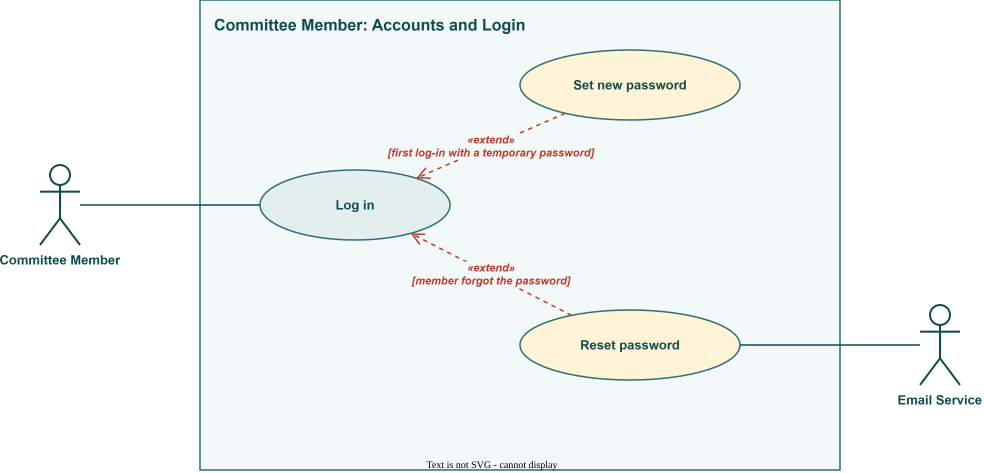
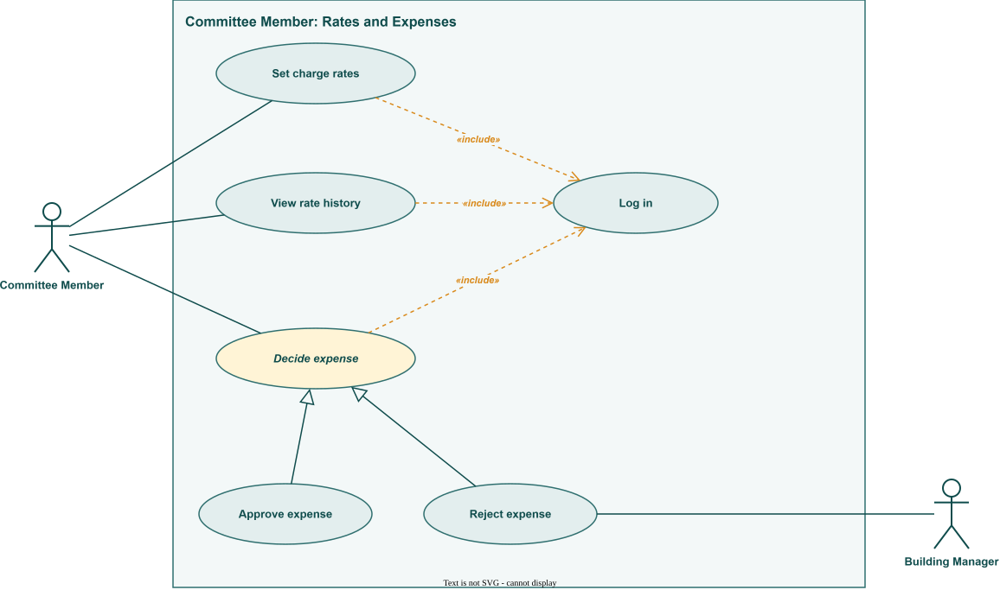
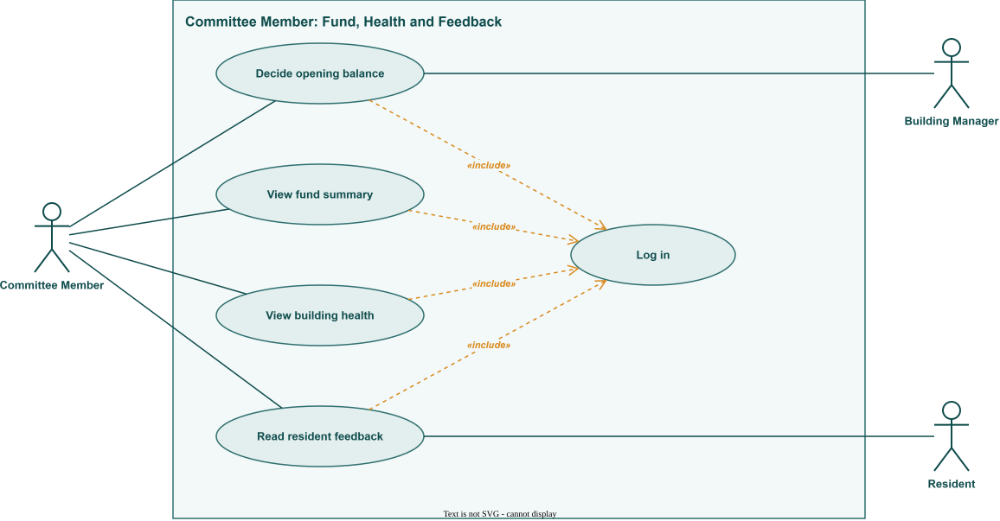
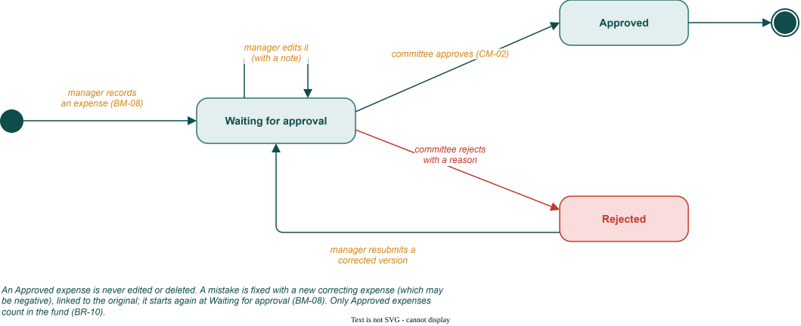
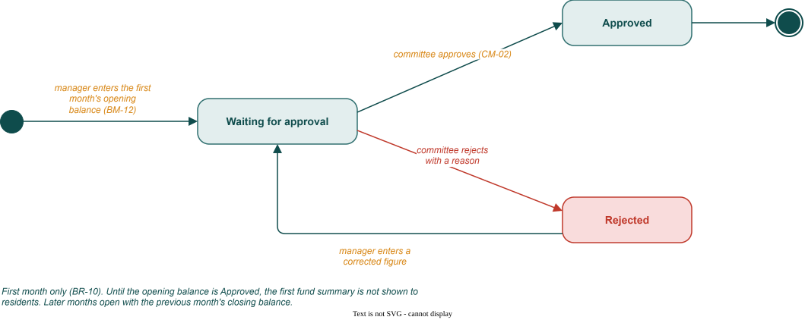
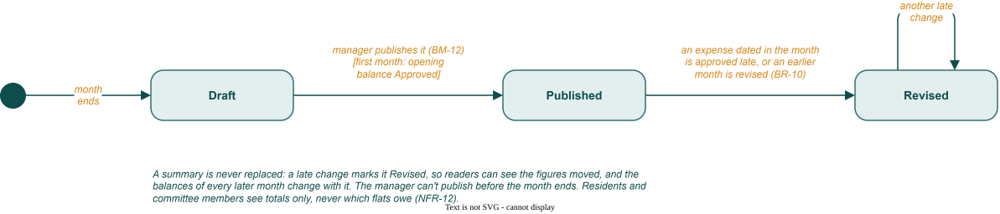
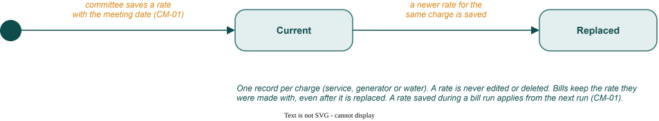

# Committee Member: use cases and state diagrams

This part covers the Committee Member user class of BariBondhu (Apartment Building Management System). Story IDs (CM), business rules (BR) and non-functional requirements (NFR) refer to the SRS.

The diagrams are `.drawio.svg` files in `diagrams/committee-member/use_case/` and `diagrams/committee-member/state_diagrams/`. To edit one, open it in draw.io or the VS Code Draw.io Integration extension. The team's data flow diagram is in [Data_Flow_Diagrams.md](../system/Data_Flow_Diagrams.md).

## 1. UML use case diagrams

The Committee Member is the primary actor. The Building Manager, the Resident and the Email Service join in as secondary actors. There are three diagrams, one per subsystem. Apart from Reset password, every use case needs the member to be logged in, which the diagrams show as «include» Log in. Decide expense is drawn in italics because it is abstract: Approve expense and Reject expense specialise it and inherit its «include».

*Figure C1: Committee Member use cases: Accounts and Login*

*Figure C2: Committee Member use cases: Rates and Expenses*

*Figure C3: Committee Member use cases: Fund, Health and Feedback*

## 2. Use case narratives

Each use case has its own narrative in the Lecture 3 table format. An alternate flow is numbered after the step it branches from, so 2a branches from step 2.

### UC-C01 Log in

| Field | Description |
|---|---|
| **Use case** | UC-C01 Log in (CM-05) |
| **Actors** | Primary: Committee Member |
| **Precondition** | The manager has created the committee account (BM-02) and the account is active. |
| **Trigger** | The committee member opens BariBondhu while logged out. |
| **Main success scenario** | 1. Committee member enters the username and password. 2. System checks them and checks that the account is active. 3. System opens the committee dashboard. |
| **Alternate flows** | 1a. Committee member taps Forgot password → «extend» Reset password (UC-C03). 2a. First log-in with a temporary password → «extend» Set new password (UC-C02), then step 3. 2b. Wrong username or password → error shown, return to step 1. After 5 wrong passwords in a row, this device must wait 15 minutes (BR-14). 2c. The account has been deactivated → log-in refused. Past records stay (BM-02). 3a. A resident, guard, maintenance or manager user tries to open a committee page → access refused. A member who also lives in the building uses the household account for flat matters. It is a separate log-in (CM-05). |
| **Postcondition** | The committee member is logged in and can use only the committee member pages. |
| **Non-functional** | HTTPS only (NFR-03). Passwords stored only as salted hashes (NFR-04). Wrong-password limit (NFR-05, BR-14). Session ends after 7 days idle (NFR-07). Every page checks the role (NFR-06). |

### UC-C02 Set new password

| Field | Description |
|---|---|
| **Use case** | UC-C02 Set new password (CM-05, BR-15) |
| **Actors** | Primary: Committee Member |
| **Precondition** | The account has a temporary password that is less than 7 days old. |
| **Trigger** | The user logs in with the temporary password (extends Log in at step 2). |
| **Main success scenario** | 1. System asks for a new password. 2. Committee member enters the new password twice. 3. System checks that it has at least 8 characters and that both entries match. 4. System saves the password and Log in continues at step 3. |
| **Alternate flows** | 3a. Too short, or the two entries differ → System says what is wrong, return to step 2. Temporary password older than 7 days → log-in refused, and the committee member is told to ask the manager for a new one. |
| **Postcondition** | The temporary password no longer works. The account is Active. |
| **Non-functional** | At least 8 characters, stored only as a salted hash, never sent by email (NFR-04). |

### UC-C03 Reset password

| Field | Description |
|---|---|
| **Use case** | UC-C03 Reset password (CM-05, BR-15) |
| **Actors** | Primary: Committee Member · Secondary: Email Service |
| **Precondition** | The committee member is not logged in. |
| **Trigger** | The user taps Forgot password on the log-in screen (extends Log in at step 1). |
| **Main success scenario** | 1. User enters the username. 2. System finds the email address on the account. 3. System sends a reset link, valid for 30 minutes, through the Email Service. 4. User opens the link and enters a new password of at least 8 characters. 5. System saves the password and the committee member logs in (UC-C01). |
| **Alternate flows** | 2a. The account has no email address → the screen tells the committee member to ask the manager for a new temporary password. The use case ends. 4a. The link is older than 30 minutes or was already used → "This link has expired", return to step 1. |
| **Postcondition** | The new password works and the old one does not. |
| **Non-functional** | The reset link expires after 30 minutes. The password itself is never emailed (NFR-04). |

### UC-C04 Set charge rates

| Field | Description |
|---|---|
| **Use case** | UC-C04 Set charge rates (CM-01) |
| **Actors** | Primary: Committee Member · Secondary: Building Manager (makes the bills from the rates, BM-03) |
| **Precondition** | The member is logged in («include» Log in). |
| **Trigger** | After a committee meeting, the member opens Charge rates. |
| **Main success scenario** | 1. System shows each charge (service, generator, water) with its current rate and the date it started. 2. Member enters the new rate for one or more charges, and the date of the meeting that agreed them. 3. System checks that each rate is a number of zero or more and that a meeting date is given. 4. System saves the rates with the member's name and the time, and adds them to Rate history. 5. System confirms that the new rates apply from the next bill run. |
| **Alternate flows** | 3a. A blank or negative rate, or no meeting date → "Enter a valid rate and meeting date". Nothing changes. 4a. A bill run is in progress → the run finishes with its starting rates; the new rates apply from the next run. 4b. Bills for the current month already exist → those bills keep their old rates. |
| **Postcondition** | The new rates are saved and in Rate history. No bill already made has changed. |
| **Non-functional** | A failed save is shown within 5 s and never shown as saved (NFR-17). Every change is logged with old and new values (NFR-27). Charge types can change without a code change (NFR-30). |

### UC-C05 View rate history

| Field | Description |
|---|---|
| **Use case** | UC-C05 View rate history (CM-01) |
| **Actors** | Primary: Committee Member |
| **Precondition** | The member is logged in («include» Log in). |
| **Trigger** | The member opens Rate history. |
| **Main success scenario** | 1. System lists every rate change: the charge, old rate, new rate, who changed it, when, and the meeting date. 2. Member reads the list. |
| **Alternate flows** | 1a. No rate has ever changed → the list is empty and says so. |
| **Postcondition** | Nothing changes. The rate history can't be edited or deleted. |
| **Non-functional** | Every change shown was logged when it was saved (NFR-27). Amounts in BDT, times in Asia/Dhaka (NFR-22). |

### UC-C06 Decide expense (abstract)

| Field | Description |
|---|---|
| **Use case** | UC-C06 Decide expense (abstract) (CM-02) |
| **Actors** | Primary: Committee Member · Secondary: Building Manager (records the expense, BM-08) |
| **Precondition** | The member is logged in («include» Log in). The expense is Waiting for approval. |
| **Trigger** | The member opens an expense from the list waiting for approval. |
| **Main success scenario** | 1. System shows the amount, category, expense date, description, receipt photo if any, and who recorded it. 2. Member reads the receipt and the description. 3. Member chooses Approve (UC-C07) or Reject (UC-C08). |
| **Alternate flows** | 1a. The expense is already Approved or Rejected → its current status is shown. Nothing changes. |
| **Postcondition** | The expense is Approved or Rejected. Only Approved expenses count in the fund (BR-10). |
| **Non-functional** | At most 4 taps from the home screen (NFR-24). Receipt photos are JPG or PNG of at most 5 MB (NFR-09). |

### UC-C07 Approve expense

| Field | Description |
|---|---|
| **Use case** | UC-C07 Approve expense (CM-02) |
| **Actors** | Primary: Committee Member · Secondary: Building Manager |
| **Precondition** | The expense is Waiting for approval. |
| **Trigger** | The member taps Approve (specialises Decide expense). |
| **Main success scenario** | 1. System sets the expense to Approved and records the member's name and the time. 2. System counts it in the fund summary for its expense date (BR-10). 3. System shows the expense as Approved. |
| **Alternate flows** | 1a. Already decided by another member → the current status is shown. Nothing changes. 2a. The expense is dated in a published month → that month's summary is marked Revised, and later months' balances change with it (BM-12). Member tries to change the amount of, or delete, an Approved expense → refused, and told to ask the manager for a correcting expense (BM-08). |
| **Postcondition** | The expense is Approved and counted. |
| **Non-functional** | Totals equal the saved records (NFR-26). Logged with old and new values (NFR-27). |

### UC-C08 Reject expense

| Field | Description |
|---|---|
| **Use case** | UC-C08 Reject expense (CM-02) |
| **Actors** | Primary: Committee Member · Secondary: Building Manager (sees the reason and may resubmit) |
| **Precondition** | The expense is Waiting for approval. |
| **Trigger** | The member taps Reject (specialises Decide expense). |
| **Main success scenario** | 1. System asks for a reason. 2. Member writes the reason. 3. System sets the expense to Rejected, saves the reason and shows it to the manager. |
| **Alternate flows** | 1a. Already decided → the current status is shown. Nothing changes. 2a. No reason written → "Write a reason". Nothing changes. The manager resubmits a corrected version → it returns to Waiting for approval (BM-08). |
| **Postcondition** | The expense is Rejected and not counted in the fund (BR-10). |
| **Non-functional** | The error message says what to do next (NFR-25). Logged (NFR-27). |

### UC-C09 Decide opening balance

| Field | Description |
|---|---|
| **Use case** | UC-C09 Decide opening balance (CM-02, BM-12, BR-10) |
| **Actors** | Primary: Committee Member · Secondary: Building Manager (enters the first month's opening balance) |
| **Precondition** | The member is logged in («include» Log in). The manager has entered the first month's opening balance, and it is Waiting for approval. This happens in the first month only. |
| **Trigger** | The member opens the opening balance from the approvals list. |
| **Main success scenario** | 1. System shows the amount and the date the manager entered. 2. Member approves it. 3. System sets it to Approved and records the member's name and the time. 4. The first fund summary can now be shown to residents (BM-12). |
| **Alternate flows** | 1a. Already decided → the current status is shown. Nothing changes. 2a. Member rejects it and writes a reason → it is Rejected, and the manager sees the reason and enters a corrected figure, which comes back as Waiting for approval. 2b. Reject with no reason → "Write a reason". Nothing changes. |
| **Postcondition** | The opening balance is Approved, or Rejected and waiting for the manager's correction. |
| **Non-functional** | Totals equal the saved records (NFR-26). Logged with old and new values (NFR-27). |

### UC-C10 View fund summary

| Field | Description |
|---|---|
| **Use case** | UC-C10 View fund summary (CM-04) |
| **Actors** | Primary: Committee Member |
| **Precondition** | The member is logged in («include» Log in). The manager publishes each month's summary (BM-12). |
| **Trigger** | The member opens Fund summary. |
| **Main success scenario** | 1. System shows the latest published month: opening balance, total collected, total spent by category (repair, salary, utility, other), closing balance, total outstanding, and how many expenses are waiting for approval. 2. Member can pick an earlier published month. |
| **Alternate flows** | 1a. This month isn't published yet → "Not published yet" and the last published month are shown. 1b. Some flats are unpaid → only the total outstanding is shown, never which flats owe it. 1c. The month was Revised → the summary says so. |
| **Postcondition** | Nothing changes. |
| **Non-functional** | Totals only (NFR-12). Loads within 3 s for 95% of requests (NFR-01). Equals the saved records (NFR-26). |

### UC-C11 View building health

| Field | Description |
|---|---|
| **Use case** | UC-C11 View building health (CM-04) |
| **Actors** | Primary: Committee Member |
| **Precondition** | The member is logged in («include» Log in). |
| **Trigger** | The member opens the dashboard. |
| **Main success scenario** | 1. System counts the tickets Reported for more than 24 hours (1 hour if Urgent) with nobody assigned (BM-06). 2. System shows the count. Only the manager can assign tickets. |
| **Alternate flows** | 1a. No ticket is late → the count is zero. |
| **Postcondition** | Nothing changes. |
| **Non-functional** | Loads within 3 s for 95% of requests (NFR-01). The late count can't be switched off (NFR-16). |

### UC-C12 Read resident feedback

| Field | Description |
|---|---|
| **Use case** | UC-C12 Read resident feedback (CM-03) |
| **Actors** | Primary: Committee Member · Secondary: Resident (gives the rating and comment, RES-07) |
| **Precondition** | The member is logged in («include» Log in). |
| **Trigger** | The member opens Feedback for a month. |
| **Main success scenario** | 1. System lists each service (cleaning, security, maintenance, lift, other) with its average rating, the number of ratings, and the comments. 2. Member reads the comments. |
| **Alternate flows** | 1a. No feedback for the month → "No feedback for this month". 1b. Anonymous feedback → no flat number or account name is shown, on screen or in exports. 2a. Member tries to follow an entry to that flat's bills or payments → access refused. |
| **Postcondition** | Nothing changes. |
| **Non-functional** | Anonymous feedback never shows the flat or the account (NFR-11). Role check on every page and API (NFR-06). |

## 3. State diagrams

Each object has one state diagram, drawn by one member. The committee owns these four, because its decisions move them. A double ring marks the end of the object's life.

### Expense

*Figure C4: State diagram of an Expense*

An Approved expense never changes. A mistake is fixed by a new correcting expense, linked to the original, which starts at Waiting for approval. A rejected expense is resubmitted instead (BM-08).

### Opening balance

*Figure C5: State diagram of an Opening balance*

First month only (BR-10). Until the opening balance is Approved, the first fund summary isn't shown to residents (BM-12, CM-02).

### Fund summary

*Figure C6: State diagram of a Fund summary*

A summary is marked Revised, not replaced, when a late approval changes a published month, so readers can see that the figures moved. The balances of every later month change with it (BM-12).

### Charge rate

*Figure C7: State diagram of a Charge rate*

A rate record is never edited or deleted. It becomes Replaced when a newer rate for the same charge is saved, and a bill keeps the rate it was made with (CM-01).
