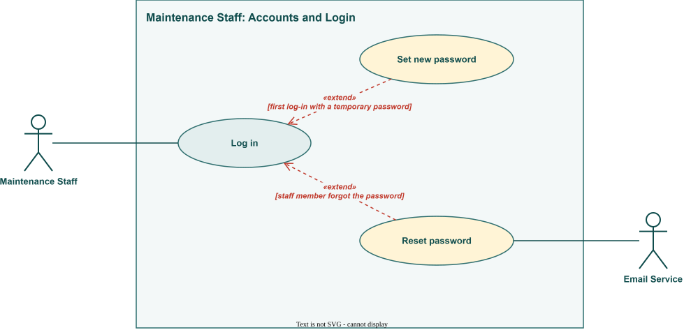
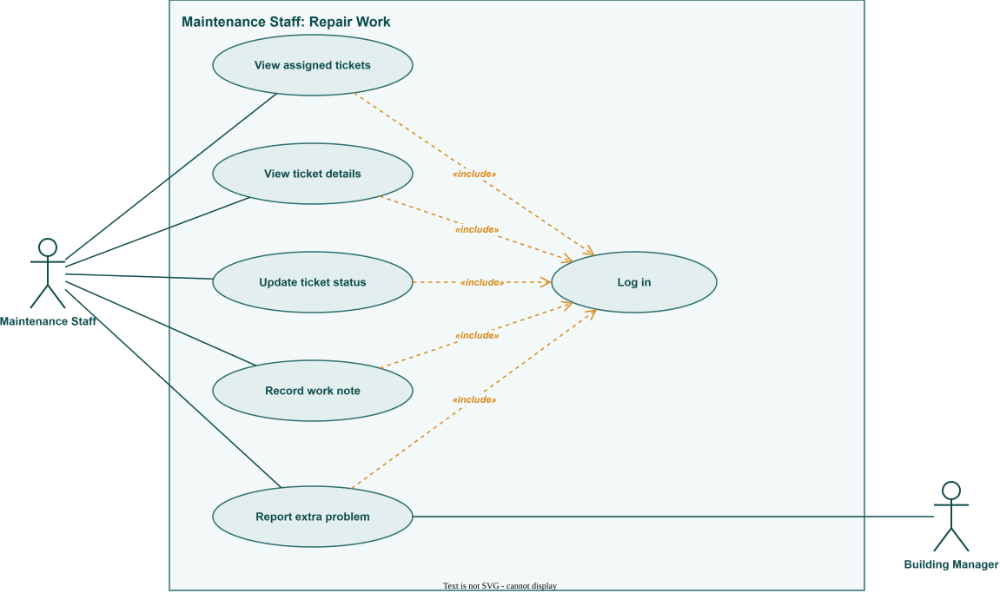
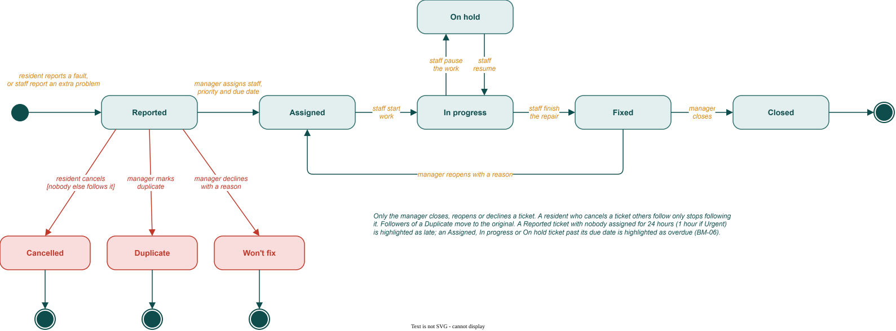

# Maintenance Staff: use cases and state diagrams

This part covers the Maintenance Staff user class of BariBondhu (Apartment Building Management System). Story IDs (MNT), business rules (BR) and non-functional requirements (NFR) refer to the SRS.

The diagrams are `.drawio.svg` files in `diagrams/maintenance-staff/`. To edit one, open it in draw.io or the VS Code Draw.io Integration extension. The team's data flow diagram is in [Data\_Flow\_Diagrams.md](../system/Data_Flow_Diagrams.md).

## 1\. UML use case diagrams

The Maintenance Staff member is the primary actor. The Building Manager and the Email Service join in as secondary actors. There are two diagrams. Apart from Reset password, every use case needs the staff member to be logged in, which the diagrams show as «include» Log in. Staff can't assign, close or reopen tickets.

*Figure M1: Maintenance Staff use cases: Accounts and Login*

*Figure M2: Maintenance Staff use cases: Repair Work*

## 2\. Use case narratives

Each use case has its own narrative in the Lecture 3 table format. An alternate flow is numbered after the step it branches from, so 2a branches from step 2\.

### UC-MNT01 Log in

| Field | Description |
| :---- | :---- |
| **Use case** | UC-MNT01 Log in (MNT-06) |
| **Actors** | Primary: Maintenance Staff |
| **Precondition** | The manager has created the maintenance account (BM-02) and the account is active. |
| **Trigger** | The staff member opens BariBondhu while logged out. |
| **Main success scenario** | 1\. Staff member enters the username and password. 2\. System checks them and checks that the account is active. 3\. System opens the list of assigned tickets. |
| **Alternate flows** | 1a. Staff member taps Forgot password → «extend» Reset password (UC-MNT03). 2a. First log-in with a temporary password → «extend» Set new password (UC-MNT02), then step 3\. 2b. Wrong username or password → error shown, return to step 1\. After 5 wrong passwords in a row, this device must wait 15 minutes (BR-14). 2c. The account has been deactivated → log-in refused. Past records stay (BM-02). 3a. A user of any other role tries to open a maintenance page → access refused. |
| **Postcondition** | The staff member is logged in and can use only the staff member pages. |
| **Non-functional** | HTTPS only (NFR-03). Passwords stored only as salted hashes (NFR-04). Wrong-password limit (NFR-05, BR-14). Session ends after 15 minutes idle (NFR-07). Every page checks the role (NFR-06). |

### UC-MNT02 Set new password

| Field | Description |
| :---- | :---- |
| **Use case** | UC-MNT02 Set new password (MNT-06, BR-15) |
| **Actors** | Primary: Maintenance Staff |
| **Precondition** | The account has a temporary password that is less than 7 days old. |
| **Trigger** | The user logs in with the temporary password (extends Log in at step 2). |
| **Main success scenario** | 1\. System asks for a new password. 2\. Staff member enters the new password twice. 3\. System checks that it has at least 8 characters and that both entries match. 4\. System saves the password and Log in continues at step 3\. |
| **Alternate flows** | 3a. Too short, or the two entries differ → System says what is wrong, return to step 2\. Temporary password older than 7 days → log-in refused, and the staff member is told to ask the manager for a new one. |
| **Postcondition** | The temporary password no longer works. The account is Active. |
| **Non-functional** | At least 8 characters, stored only as a salted hash, never sent by email (NFR-04). |

### UC-MNT03 Reset password

| Field | Description |
| :---- | :---- |
| **Use case** | UC-MNT03 Reset password (MNT-06, BR-15) |
| **Actors** | Primary: Maintenance Staff · Secondary: Email Service |
| **Precondition** | The staff member is not logged in. |
| **Trigger** | The user taps Forgot password on the log-in screen (extends Log in at step 1). |
| **Main success scenario** | 1\. User enters the username. 2\. System finds the email address on the account. 3\. System sends a reset link, valid for 30 minutes, through the Email Service. 4\. User opens the link and enters a new password of at least 8 characters. 5\. System saves the password and the staff member logs in (UC-MNT01). |
| **Alternate flows** | 2a. The account has no email address → the screen tells the staff member to ask the manager for a new temporary password. The use case ends. 4a. The link is older than 30 minutes or was already used → "This link has expired", return to step 1\. |
| **Postcondition** | The new password works and the old one does not. |
| **Non-functional** | The reset link expires after 30 minutes. The password itself is never emailed (NFR-04). |

### UC-MNT04 View assigned tickets

| Field | Description |
| :---- | :---- |
| **Use case** | UC-MNT04 View assigned tickets (MNT-01) |
| **Actors** | Primary: Maintenance Staff |
| **Precondition** | The staff member is logged in («include» Log in). |
| **Trigger** | The staff member opens Tickets. |
| **Main success scenario** | 1\. System finds the tickets assigned to this staff member. 2\. System lists each ticket's title, place, priority, due date and status, Urgent first and then by due date. |
| **Alternate flows** | 1a. Nothing is assigned → "No tickets assigned to you". Staff member tries to open a ticket assigned to someone else → access refused. |
| **Postcondition** | Nothing changes. |
| **Non-functional** | Loads within 3 s for 95% of requests (NFR-01). Staff see only their own tickets (NFR-06). |

### UC-MNT05 View ticket details

| Field | Description |
| :---- | :---- |
| **Use case** | UC-MNT05 View ticket details (MNT-02) |
| **Actors** | Primary: Maintenance Staff |
| **Precondition** | The staff member is logged in («include» Log in). The ticket is assigned to them. |
| **Trigger** | The staff member opens a ticket from the list. |
| **Main success scenario** | 1\. System shows the description, category, place or flat number, photo, the times someone is home, priority, due date and the manager's instructions. 2\. Staff member reads them before going to the site. |
| **Alternate flows** | 1a. The ticket has been reassigned to someone else → "This ticket is no longer assigned to you". |
| **Postcondition** | Nothing changes. |
| **Non-functional** | The resident's phone number is never shown; if the staff member needs the resident, they go through the manager (NFR-10). At most 3 taps from the home screen (NFR-24). |

### UC-MNT06 Update ticket status

| Field | Description |
| :---- | :---- |
| **Use case** | UC-MNT06 Update ticket status (MNT-03) |
| **Actors** | Primary: Maintenance Staff |
| **Precondition** | The staff member is logged in («include» Log in). The ticket is assigned to them. |
| **Trigger** | The staff member starts, pauses, resumes or finishes the work. |
| **Main success scenario** | 1\. Staff member starts work, and the ticket changes from Assigned to In progress. 2\. Staff member finishes the repair, and the ticket changes from In progress to Fixed. 3\. System saves each change with the time, and notifies the reporter and every follower. |
| **Alternate flows** | 1a. Work can't continue (waiting for parts or for access) → staff member sets On hold with a reason; when work resumes it returns to In progress. 2a. The ticket is Assigned → Fixed isn't offered; it can't skip In progress. 2b. The ticket is Fixed → Closed isn't offered. Only the manager closes tickets (BM-07). 3a. The save fails → an error within 5 s, and the status is never shown as saved. |
| **Postcondition** | The ticket shows the latest saved status and time. |
| **Non-functional** | Each change is logged with the account, date and time (NFR-27). A failed save is never shown as saved (NFR-17). Notifications within 1 minute (NFR-29). |

### UC-MNT07 Record work note

| Field | Description |
| :---- | :---- |
| **Use case** | UC-MNT07 Record work note (MNT-04) |
| **Actors** | Primary: Maintenance Staff |
| **Precondition** | The staff member is logged in («include» Log in) and has an assigned ticket open. |
| **Trigger** | The staff member taps Add note. |
| **Main success scenario** | 1\. Staff member writes a note of up to 1,000 characters about the work. 2\. Staff member taps Save. 3\. System stores the note on the ticket with the staff member's name and the time, and shows "Note saved". 4\. The manager sees the note when opening the ticket (BM-07). |
| **Alternate flows** | 1a. The note is empty → "Write a note". Nothing is saved. 3a. The save fails → an error within 5 s, and the note is never shown as saved. |
| **Postcondition** | The note is stored on the ticket. The SRS gives no way to edit or delete a note. |
| **Non-functional** | A failed save is never shown as saved (NFR-17). Logged (NFR-27). |

### UC-MNT08 Report extra problem

| Field | Description |
| :---- | :---- |
| **Use case** | UC-MNT08 Report extra problem (MNT-05) |
| **Actors** | Primary: Maintenance Staff · Secondary: Building Manager |
| **Precondition** | The staff member is logged in («include» Log in) and is working on an assigned ticket. |
| **Trigger** | During a repair, the staff member finds another problem and taps Report extra problem. |
| **Main success scenario** | 1\. Staff member enters a category, a description and a place. 2\. System creates a new ticket as Reported, marked Found by staff and linked to the ticket being worked on. 3\. System notifies the manager, who assigns it like any other ticket (BM-06). |
| **Alternate flows** | 1a. The category, description or place is empty → the System says what is missing. Nothing is saved. |
| **Postcondition** | A new Reported ticket exists in the manager's list. |
| **Non-functional** | A failed save is never shown as saved (NFR-17). Logged (NFR-27). |

## 3\. State diagrams

Each object has one state diagram, drawn by one member. Maintenance staff own the Fault ticket, because they move it through most of its states. An extra problem a staff member reports is an ordinary ticket marked Found by staff, so it has no diagram of its own, and the SRS gives a work note no edit or delete step, so it has no states. The staff account is in the Building Manager's Staff account diagram.

### Fault ticket

*Figure M3: State diagram of a Fault ticket*

Residents can cancel a ticket only while it is still Reported and nobody else follows it; if others have tapped "Me too", cancelling only removes the resident as a follower. After the manager assigns it, closing, reopening or declining it is the manager's call (BM-06, BM-07).