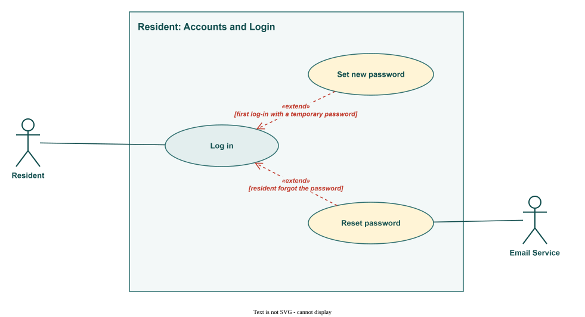
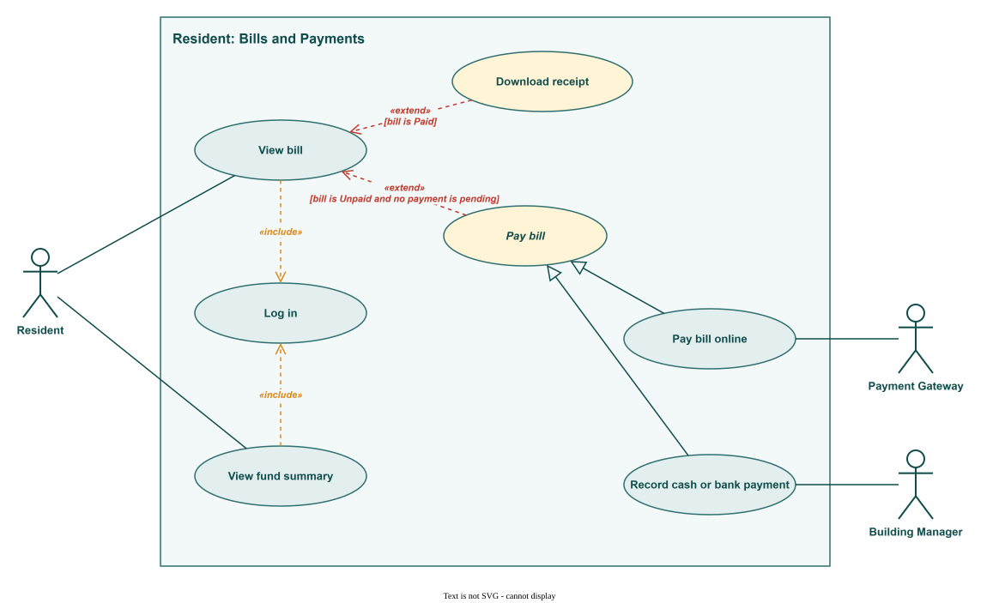
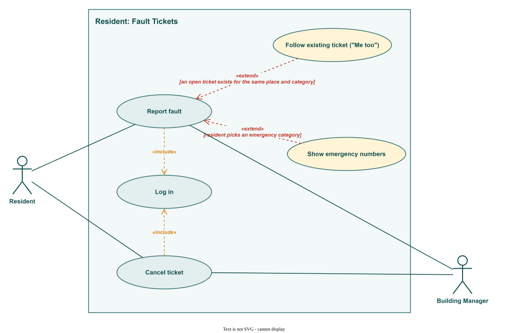
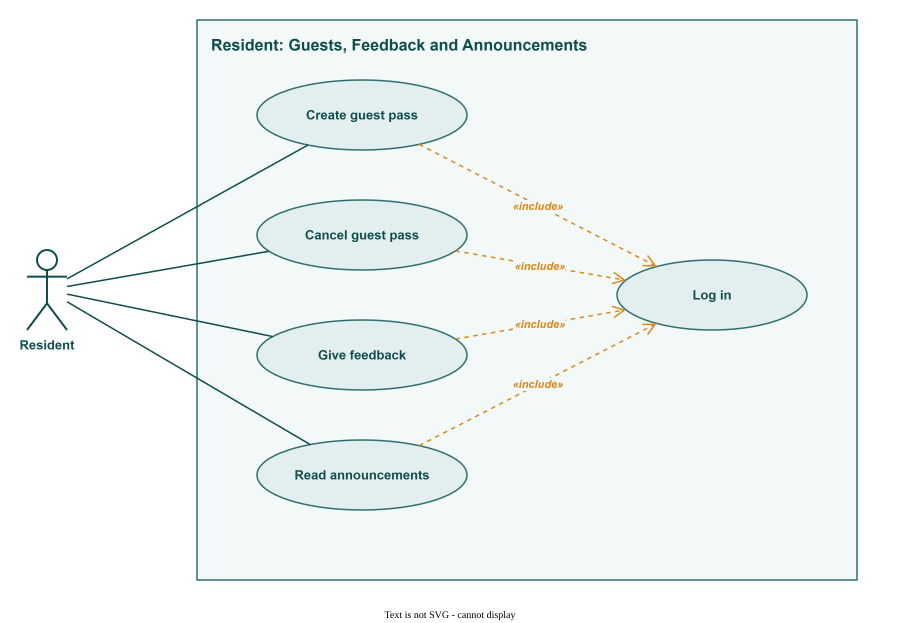
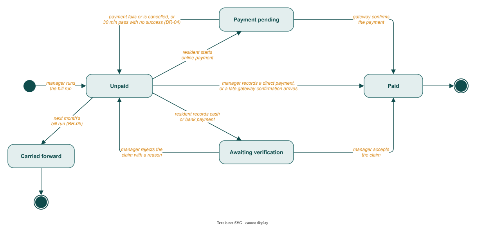
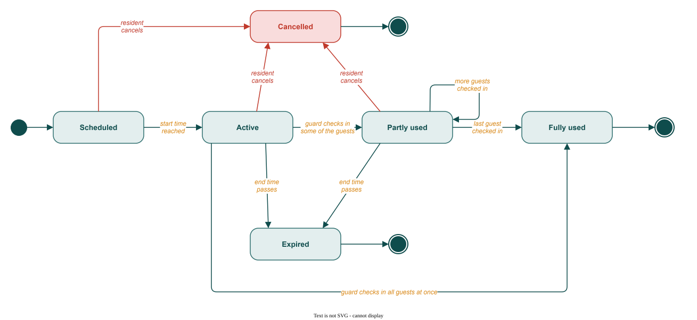
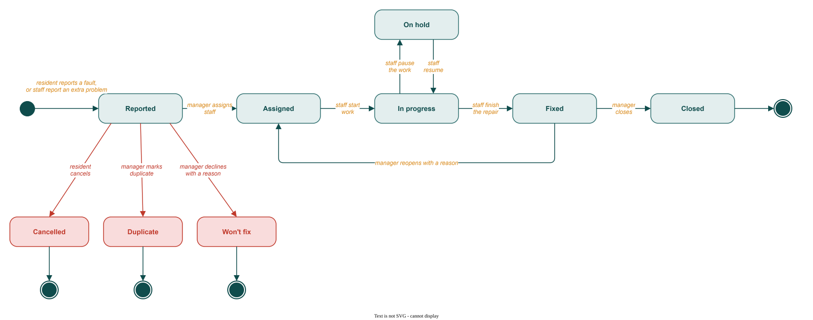
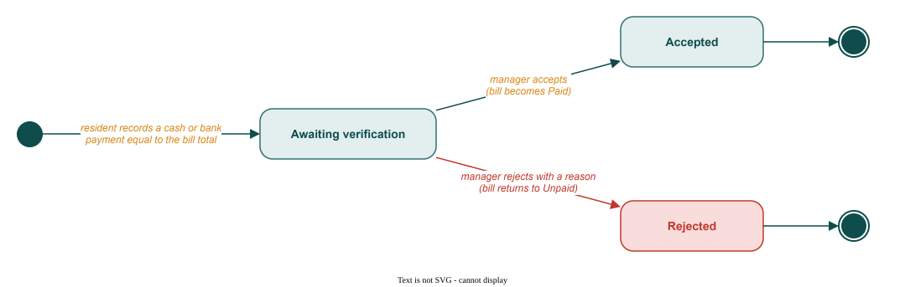
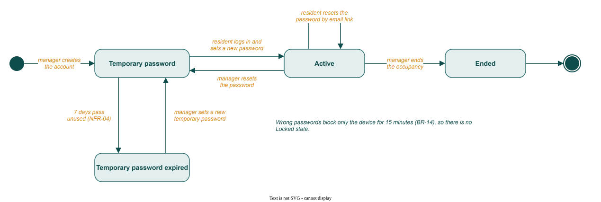
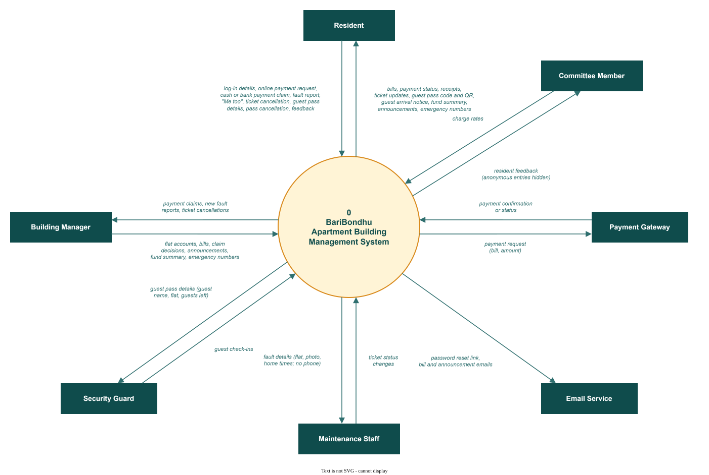

# Resident: use cases, state diagrams and DFD

This part covers the Resident user class of BariBondhu (Apartment Building Management System). Story IDs (RES), business rules (BR) and non-functional requirements (NFR) refer to the SRS.

The diagrams are `.drawio.svg` files in `diagrams/resident/`. To edit one, open it in draw.io or the VS Code Draw.io Integration extension.

## 1. UML use case diagrams

The Resident is the primary actor. The Payment Gateway, the Email Service and the Building Manager join in as secondary actors. There are four diagrams, one per subsystem. Apart from Reset password, every use case needs the resident to be logged in, which the diagrams show as «include» Log in. Pay bill is drawn in italics because it is abstract: a resident never just "pays", they pay online or record a cash or bank payment. The condition for each «extend» is written on its arrow.

*Figure R1: Resident use cases: Accounts and Login*

*Figure R2: Resident use cases: Bills and Payments*

*Figure R3: Resident use cases: Fault Tickets*

*Figure R4: Resident use cases: Guests, Feedback and Announcements*

## 2. Use case narratives

Each use case has its own narrative in the Lecture 3 table format. An alternate flow is numbered after the step it branches from, so 2a branches from step 2.

### UC-R01 Log in

| Field | Description |
|---|---|
| **Use case** | UC-R01 Log in (RES-06) |
| **Actors** | Primary: Resident |
| **Precondition** | The manager has created the household account (BM-02) and the occupancy is active. |
| **Trigger** | The resident opens BariBondhu while logged out. |
| **Main success scenario** | 1. Resident enters the username and password. 2. System checks them and checks that the occupancy is active. 3. System opens the resident home screen. |
| **Alternate flows** | 1a. Resident taps Forgot password → «extend» Reset password (UC-R03). 2a. First log-in with a temporary password → «extend» Set new password (UC-R02), then step 3. 2b. Wrong username or password → error shown, return to step 1. After 5 wrong passwords in a row, this device must wait 15 minutes and the screen shows the time left (BR-14). 2c. The occupancy has ended → log-in refused. The records are kept but the next household can't see them (BR-09). 3a. Resident tries to open a manager, guard, maintenance, committee or administrator page → access refused. |
| **Postcondition** | The resident is logged in and can see only their own household's data. |
| **Non-functional** | HTTPS only (NFR-03). Passwords stored only as salted hashes (NFR-04). Wrong-password limit per device (NFR-05). Session ends after 7 days idle (NFR-07). |

### UC-R02 Set new password

| Field | Description |
|---|---|
| **Use case** | UC-R02 Set new password (RES-06) |
| **Actors** | Primary: Resident |
| **Precondition** | The account has a temporary password from the manager that is less than 7 days old. |
| **Trigger** | The resident logs in with the temporary password (extends Log in at step 2). |
| **Main success scenario** | 1. System asks for a new password. 2. Resident enters the new password twice. 3. System checks that it has at least 8 characters and that both entries match. 4. System saves the password and Log in continues at step 3. |
| **Alternate flows** | 3a. Too short, or the two entries differ → System says what is wrong, return to step 2. Temporary password older than 7 days → log-in refused, and the resident is told to ask the manager for a new one. |
| **Postcondition** | The temporary password no longer works. The account is Active. |
| **Non-functional** | At least 8 characters, stored only as a salted hash, never sent by email (NFR-04). |

### UC-R03 Reset password

| Field | Description |
|---|---|
| **Use case** | UC-R03 Reset password (RES-06) |
| **Actors** | Primary: Resident · Secondary: Email Service |
| **Precondition** | The resident is not logged in. |
| **Trigger** | The resident taps Forgot password on the log-in screen (extends Log in at step 1). |
| **Main success scenario** | 1. Resident enters the username. 2. System finds the email address on the account. 3. System sends a reset link, valid for 30 minutes, through the Email Service. 4. Resident opens the link and enters a new password of at least 8 characters. 5. System saves the password and the resident logs in (UC-R01). |
| **Alternate flows** | 2a. The account has no email address → the screen tells the resident to ask the manager to reset it. The use case ends. 4a. The link is older than 30 minutes or was already used → "This link has expired", return to step 1. |
| **Postcondition** | The new password works and the old one does not. |
| **Non-functional** | The reset link expires after 30 minutes. The password itself is never emailed (NFR-04). |

### UC-R04 View bill

| Field | Description |
|---|---|
| **Use case** | UC-R04 View bill (RES-01) |
| **Actors** | Primary: Resident |
| **Precondition** | The resident is logged in («include» Log in). |
| **Trigger** | The resident opens Dues or taps a bill reminder notification. |
| **Main success scenario** | 1. System finds the household's current bill. 2. System shows each charge (service, generator, water) with its rate, any Carried forward or adjustment line, the total, the due date and the status. 3. Resident reads the bill. |
| **Alternate flows** | 2a. The bill is Unpaid and no payment is pending → Pay is offered: «extend» Pay bill (UC-R05). 2b. The bill is Paid → «extend» Download receipt (UC-R08). 2c. The bill is Payment pending or Awaiting verification → the status is shown and both payment options are disabled (BR-03). 3a. Resident tries to open another flat's bill → access refused. |
| **Postcondition** | Nothing changes. |
| **Non-functional** | Dues loads within 3 s for 95% of requests on Fast 3G (NFR-01). A resident reaches only their own occupancy's data (NFR-06). Totals always equal the saved records (NFR-26). |

### UC-R05 Pay bill (abstract)

| Field | Description |
|---|---|
| **Use case** | UC-R05 Pay bill (abstract) (RES-01, RES-04) |
| **Actors** | Primary: Resident · Secondary: depends on the payment method |
| **Precondition** | The bill is Unpaid and no payment is pending (the extend condition on View bill). |
| **Trigger** | The resident taps Pay on the bill. |
| **Main success scenario** | 1. System shows the bill total and the two ways to pay. 2. Resident chooses Pay online, which continues as Pay bill online (UC-R06), or Record cash or bank payment, which continues as UC-R07. |
| **Alternate flows** | 1a. The bill changed in the meantime, for example the manager recorded a payment → System shows the new status and offers no payment. |
| **Postcondition** | Set by the chosen method (UC-R06 or UC-R07). |
| **Non-functional** | Paying the current bill takes at most 4 taps from the home screen (NFR-24). A bill becomes Paid only as set out in BR-02 (NFR-15). |

### UC-R06 Pay bill online

| Field | Description |
|---|---|
| **Use case** | UC-R06 Pay bill online (RES-01) |
| **Actors** | Primary: Resident · Secondary: Payment Gateway |
| **Precondition** | The bill is Unpaid and no payment is pending. |
| **Trigger** | The resident chooses Pay online (specialises Pay bill). |
| **Main success scenario** | 1. System sets the bill to Payment pending and disables Record cash or bank payment (BR-03). 2. System sends a payment request for the bill total to the Payment Gateway and opens its payment page. 3. Resident pays on the gateway's page. 4. Payment Gateway confirms the payment to the system server to server. 5. System sets the bill to Paid, creates a receipt with a receipt number and the gateway's transaction ID, and notifies the resident. |
| **Alternate flows** | 3a. The payment fails or the resident cancels → the bill returns to Unpaid and the gateway's reason is shown. 3b. The resident closes the app halfway → steps 4 and 5 still happen when the gateway confirms. 4a. No confirmation after 30 minutes → System asks the gateway for the status. If there is no successful payment, the bill returns to Unpaid (BR-04). A confirmation that arrives later still makes the bill Paid. |
| **Postcondition** | The bill is Paid with a receipt, or Unpaid again with nothing charged. Each change is logged (NFR-27). |
| **Non-functional** | Only the gateway's confirmation makes the bill Paid (BR-02, NFR-15). No confirmed payment is lost after a restore (NFR-20). Sandbox gateway only, no real money (constraint 2.4). |

### UC-R07 Record cash or bank payment

| Field | Description |
|---|---|
| **Use case** | UC-R07 Record cash or bank payment (RES-04) |
| **Actors** | Primary: Resident · Secondary: Building Manager |
| **Precondition** | The bill is Unpaid and no online payment is pending. |
| **Trigger** | The resident chooses Record cash or bank payment (specialises Pay bill). |
| **Main success scenario** | 1. Resident enters the amount, the date, the method (cash or bank transfer) and, optionally, a photo of the slip. 2. System checks that the amount equals the bill total. 3. System saves the claim, sets the bill to Awaiting verification and notifies the manager. 4. Manager accepts the claim (BM-04). The bill becomes Paid and the resident can download a receipt. |
| **Alternate flows** | 1a. The photo is not a JPG or PNG, or is over 5 MB → refused with a message (NFR-09). 2a. The amount is not the bill total → "The amount must match the bill total (৳ total). Partial payments aren't supported." Nothing is saved (BR-06). 4a. Manager rejects the claim with a reason → the bill returns to Unpaid and the resident sees the reason. 4b. The due date passes while the bill is Awaiting verification → the flat stays off the defaulters list until the manager decides (BR-08). |
| **Postcondition** | The claim is recorded. The bill is Awaiting verification, then Paid or Unpaid. |
| **Non-functional** | Slip photos are visible only to the manager and the flat that uploaded them (NFR-14). A bill becomes Paid only as set out in BR-02 (NFR-15). |

### UC-R08 Download receipt

| Field | Description |
|---|---|
| **Use case** | UC-R08 Download receipt (RES-01, RES-04) |
| **Actors** | Primary: Resident |
| **Precondition** | The bill is Paid (the extend condition on View bill). |
| **Trigger** | The resident taps Download receipt. |
| **Main success scenario** | 1. System creates the receipt: receipt number, flat, month, each charge, total, payment date, method and, for online payments, the gateway's transaction ID. 2. The receipt downloads to the resident's device. |
| **Alternate flows** | 2a. The download fails because of the connection → an error is shown within 5 s and the resident can try again (NFR-17). |
| **Postcondition** | The resident has a copy of the receipt. Nothing else changes. |
| **Non-functional** | Amounts in BDT (৳) with two decimals and times in Asia/Dhaka (BR-01). |

### UC-R09 View fund summary

| Field | Description |
|---|---|
| **Use case** | UC-R09 View fund summary (RES-05) |
| **Actors** | Primary: Resident |
| **Precondition** | The resident is logged in («include» Log in). |
| **Trigger** | The resident opens Building fund. |
| **Main success scenario** | 1. System finds the latest month the manager has published. 2. System shows the opening balance, total collected, total spent by category (repair, salary, utility, other), the closing balance and the total outstanding. 3. Resident can pick an earlier published month. |
| **Alternate flows** | 1a. This month's summary isn't published yet → System shows the last published month and a note that this month isn't ready. |
| **Postcondition** | Nothing changes. |
| **Non-functional** | Only Approved expenses are counted (BR-10). Totals only, never which flats owe money (NFR-12). Loads within 3 s (NFR-01). |

### UC-R10 Report fault

| Field | Description |
|---|---|
| **Use case** | UC-R10 Report fault (RES-02) |
| **Actors** | Primary: Resident · Secondary: Building Manager |
| **Precondition** | The resident is logged in («include» Log in). |
| **Trigger** | The resident taps Report a fault. |
| **Main success scenario** | 1. Resident chooses Inside my flat, or Common area and a place from the list (BR-13). 2. Resident picks a category. 3. Resident enters a short title, a description, an optional photo and the times someone is home. 4. System creates the ticket as Reported. 5. System notifies the manager and shows the ticket under My tickets. |
| **Alternate flows** | 1a. Common area, and an open ticket already exists for that place and category → «extend» Follow existing ticket (UC-R11). 2a. Emergency category (fire, gas smell, someone stuck in a lift) → «extend» Show emergency numbers (UC-R12). If the resident then taps Log it for repair, the ticket is created as Urgent at step 4. 3a. The description is empty → "Describe the problem", nothing is created. 3b. The photo is not a JPG or PNG, or is over 5 MB → refused with a message (NFR-09). |
| **Postcondition** | The ticket is Reported, and the resident is notified each time its status changes. |
| **Non-functional** | Notifications arrive within 1 minute (NFR-29). The maintenance worker sees the flat number, photo and home times, never the resident's phone number (NFR-10). |

### UC-R11 Follow existing ticket ("Me too")

| Field | Description |
|---|---|
| **Use case** | UC-R11 Follow existing ticket ("Me too") (RES-02) |
| **Actors** | Primary: Resident |
| **Precondition** | A common-area fault, with an open ticket for the same place and category (BR-13). |
| **Trigger** | System finds the matching ticket while the resident reports a fault (extends Report fault at step 1). |
| **Main success scenario** | 1. System shows the open ticket with its title, status and number of followers. 2. Resident taps Me too. 3. System adds the resident as a follower and raises the count the manager sees. |
| **Alternate flows** | 2a. The resident's problem is different → Report fault continues at step 2 and a new ticket is created. |
| **Postcondition** | The resident follows the ticket and gets its status changes. No duplicate ticket is created. |
| **Non-functional** | Status notifications arrive within 1 minute (NFR-29). |

### UC-R12 Show emergency numbers

| Field | Description |
|---|---|
| **Use case** | UC-R12 Show emergency numbers (RES-02) |
| **Actors** | Primary: Resident |
| **Precondition** | The resident picked an emergency category. |
| **Trigger** | Selecting the emergency category (extends Report fault at step 2). |
| **Main success scenario** | 1. System shows 999 first, then the guard-desk and manager numbers, each with a one-tap Call button, before anything else. 2. Resident calls the number they need. 3. Resident taps Log it for repair, and Report fault continues at step 4 with an Urgent ticket. |
| **Alternate flows** | 3a. The resident leaves without tapping Log it for repair → no ticket is created. |
| **Postcondition** | The resident has seen the emergency numbers. If they tapped Log it for repair, an Urgent ticket exists. |
| **Non-functional** | 999 is always first and the building numbers are never empty (BR-12). The emergency screen is at most 2 taps from the home screen (NFR-16). |

### UC-R13 Cancel ticket

| Field | Description |
|---|---|
| **Use case** | UC-R13 Cancel ticket (RES-02) |
| **Actors** | Primary: Resident · Secondary: Building Manager |
| **Precondition** | The resident's own ticket is still Reported («include» Log in). |
| **Trigger** | The resident opens the ticket and taps Cancel. |
| **Main success scenario** | 1. System asks the resident to confirm. 2. Resident confirms. 3. System sets the ticket to Cancelled and notifies the manager. |
| **Alternate flows** | The ticket is already Assigned → Cancel isn't offered. Only the manager can close it. 2a. The resident doesn't confirm → nothing changes. |
| **Postcondition** | The ticket is Cancelled. |
| **Non-functional** | The change is logged with the account, date and time (NFR-27). |

### UC-R14 Create guest pass

| Field | Description |
|---|---|
| **Use case** | UC-R14 Create guest pass (RES-03) |
| **Actors** | Primary: Resident |
| **Precondition** | The resident is logged in («include» Log in). |
| **Trigger** | The resident taps New guest pass. |
| **Main success scenario** | 1. Resident enters the guest's name, the number of people (1 to 20) and a start and end date-time. 2. System checks that the end is after the start and no more than 24 hours later. 3. System creates a 6-digit code and a matching QR code (BR-11) and saves the pass. 4. Resident shares the code or the QR code from the phone. |
| **Alternate flows** | 2a. The end is before the start, or more than 24 hours after it → "Check the visit times", no pass is created. 2b. The number of people is outside 1 to 20 → refused with a message. After step 4, when the guard checks the guests in (SG-03), the resident gets a notification with the number who arrived. |
| **Postcondition** | The pass is Scheduled, or Active if it starts now. The guard can check it during its time window. |
| **Non-functional** | Codes come from a secure random source and are tied to one flat and one pass (NFR-08). At most 4 taps (NFR-24). Pass checking is available 99.5% of the time (NFR-18). The guard never sees the resident's phone number (NFR-10). |

### UC-R15 Cancel guest pass

| Field | Description |
|---|---|
| **Use case** | UC-R15 Cancel guest pass (RES-03) |
| **Actors** | Primary: Resident |
| **Precondition** | The pass is Scheduled, Active or Partly used («include» Log in). |
| **Trigger** | The resident opens the pass and taps Cancel. |
| **Main success scenario** | 1. System asks the resident to confirm. 2. Resident confirms. 3. System sets the pass to Cancelled. The code and QR code stop working at the gate straight away. |
| **Alternate flows** | The pass is Fully used or Expired → Cancel isn't offered. 2a. The resident doesn't confirm → nothing changes. |
| **Postcondition** | The pass is Cancelled. Guests already checked in stay in the visitor log. |
| **Non-functional** | A gate check returns within 2 s and shows the pass as cancelled (NFR-02). The change is logged (NFR-27). |

### UC-R16 Give feedback

| Field | Description |
|---|---|
| **Use case** | UC-R16 Give feedback (RES-07) |
| **Actors** | Primary: Resident |
| **Precondition** | The resident is logged in («include» Log in). |
| **Trigger** | The resident opens Feedback. |
| **Main success scenario** | 1. Resident picks a service: cleaning, security, maintenance, lift or other. 2. Resident picks a rating from 1 to 5, can add a comment of up to 500 characters, and can tick Send anonymously. 3. Resident submits. 4. System saves the feedback and shows a thank-you message. |
| **Alternate flows** | 3a. No rating picked → "Pick a rating", nothing is saved. 4a. The household already rated this service this month → the new feedback replaces the earlier one. |
| **Postcondition** | The feedback is saved for this month and the committee can read it (CM-03). |
| **Non-functional** | Anonymous feedback never shows the flat or the account to any reader, on screen or in exports (NFR-11). |

### UC-R17 Read announcements

| Field | Description |
|---|---|
| **Use case** | UC-R17 Read announcements (RES-08) |
| **Actors** | Primary: Resident |
| **Precondition** | The resident is logged in («include» Log in). |
| **Trigger** | The resident opens Announcements or taps an announcement notification. |
| **Main success scenario** | 1. System lists the announcements sent to all residents or to the resident's block or floor, newest first. 2. Resident opens one and reads the title, message and date. |
| **Alternate flows** | 1a. An announcement is Urgent and hasn't expired → it is also pinned at the top of the home screen until its expiry time. 1b. The manager edited an announcement → the latest version is shown. A removed announcement is no longer listed. 1c. An announcement was sent only to another block or floor → it isn't shown. |
| **Postcondition** | Nothing changes. |
| **Non-functional** | In-app notification within 1 minute, plus email when the account has one (NFR-29). Bangla and English (NFR-22). |

## 3. State diagrams

### Bill

*Figure R5: State diagram of a Bill*

A bill is in one payment flow at a time (BR-03), and only the gateway's confirmation or the manager's decision can make it Paid (BR-02). Paid and Carried forward are final. To fix a mistake on a Paid bill, the manager adds an adjustment line to next month's bill (BR-07).

### Guest pass

*Figure R6: State diagram of a Guest pass*

A pass works from its start date-time to its end date-time, 24 hours at most (BR-11). Once it is Fully used, Cancelled or Expired, it stays that way.

### Fault ticket

*Figure R7: State diagram of a Fault ticket*

Residents can cancel a ticket only while it is still Reported. After the manager assigns it, closing or reopening it is the manager's call. Tapping "Me too" adds a follower and leaves the state alone.

### Payment claim

*Figure R8: State diagram of a Payment claim*

A claim starts when the resident records a cash or bank payment, and the amount has to match the bill total (BR-06). Whatever the manager decides also moves the bill; see the Bill diagram.

### Household account

*Figure R9: State diagram of a Household account*

In Release 1 the whole household shares one account. Too many wrong passwords block the device for 15 minutes (BR-14), not the account, so there is no Locked state.

## 4. Data flow diagram (Level 0)

Level 0 draws the whole system as a single process, numbered 0. Rectangles are external entities, and each arrow carries data one way. The diagram keeps to the Resident's data: what residents send in, what they get back, and which other people or services that data reaches.

*Figure R10: DFD Level 0 (context diagram) for the Resident*
