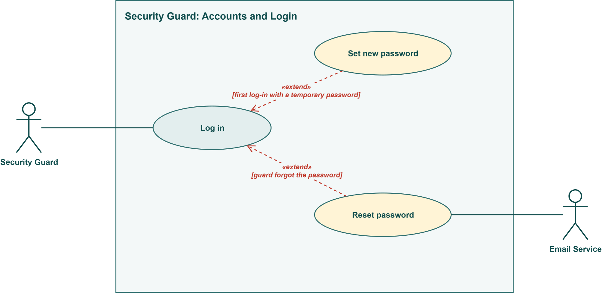
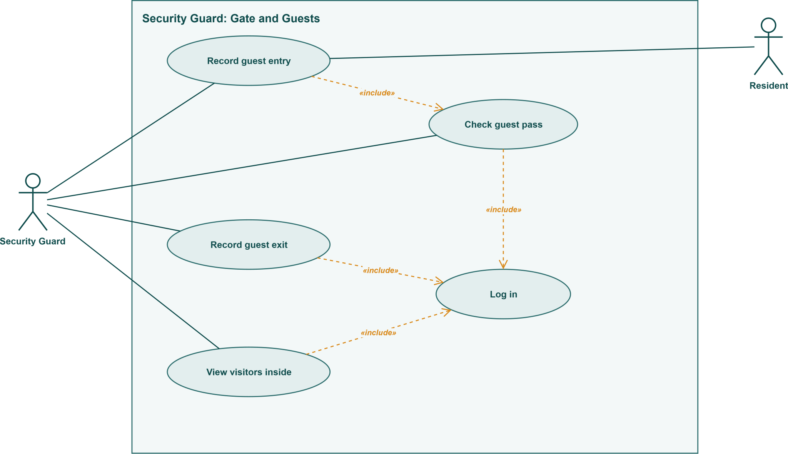
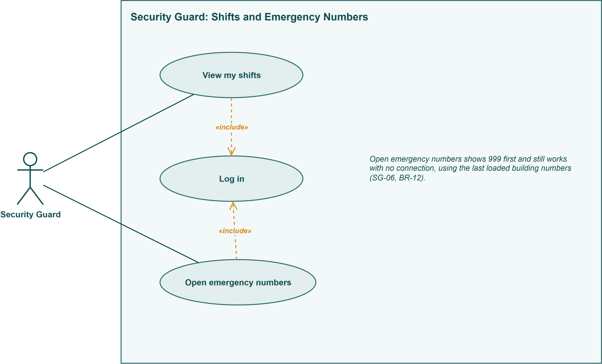
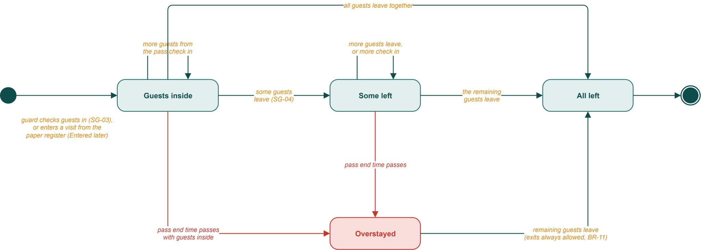
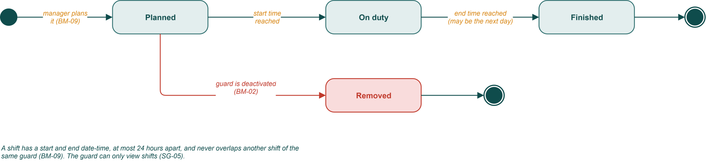

# Security Guard: use cases and state diagrams

This part covers the Security Guard user class of BariBondhu (Apartment Building Management System). Story IDs (SG), business rules (BR) and non-functional requirements (NFR) refer to the SRS.

The diagrams are `.drawio.svg` files in `diagrams/security_guard/use_case/` and `diagrams/security_guard/state_diagrams/`. To edit one, open it in draw.io or the VS Code Draw.io Integration extension. The team's data flow diagram is in [Data_Flow_Diagrams.md](../system/Data_Flow_Diagrams.md).

## 1. UML use case diagrams

The Security Guard is the primary actor. The Resident and the Email Service join in as secondary actors. There are three diagrams, one per subsystem. Apart from Reset password, every use case needs the guard to be logged in, which the diagrams show as «include» Log in. Record guest entry also includes Check guest pass, because a guest can only be checked in against a valid pass.

*Figure G1: Security Guard use cases: Accounts and Login*

*Figure G2: Security Guard use cases: Gate and Guests*

*Figure G3: Security Guard use cases: Shifts and Emergency Numbers*

## 2. Use case narratives

Each use case has its own narrative in the Lecture 3 table format. An alternate flow is numbered after the step it branches from, so 2a branches from step 2. The guard screens are in Bangla and need almost no typing (NFR-22, NFR-24).

### UC-SG01 Log in

| Field | Description |
|---|---|
| **Use case** | UC-SG01 Log in (SG-01) |
| **Actors** | Primary: Security Guard |
| **Precondition** | The manager has created the guard account (BM-02) and the account is active. |
| **Trigger** | The guard opens BariBondhu while logged out. |
| **Main success scenario** | 1. Guard enters the username and password. 2. System checks them and checks that the account is active. 3. System opens the guard dashboard. |
| **Alternate flows** | 1a. Guard taps Forgot password → «extend» Reset password (UC-SG03). 2a. First log-in with a temporary password → «extend» Set new password (UC-SG02), then step 3. 2b. Wrong username or password → error shown, return to step 1. On the shared gate device the count is kept per username: after 5 wrong passwords in a row that username must wait 15 minutes, and other guards can still log in (BR-14). 2c. The account has been deactivated → log-in refused. Past records stay (BM-02). 3a. The previous guard's shift has ended → they tap Switch guard, are logged out, and the next guard logs in with their own account. 3b. A user of any other role tries to open a guard page → access refused. |
| **Postcondition** | The guard is logged in and can use only the guard pages. |
| **Non-functional** | HTTPS only (NFR-03). Passwords stored only as salted hashes (NFR-04). Wrong-password limit (NFR-05, BR-14). Sessions on the gate device end after 15 minutes idle (NFR-07). Every page checks the role (NFR-06). |

### UC-SG02 Set new password

| Field | Description |
|---|---|
| **Use case** | UC-SG02 Set new password (SG-01, BR-15) |
| **Actors** | Primary: Security Guard |
| **Precondition** | The account has a temporary password that is less than 7 days old. |
| **Trigger** | The user logs in with the temporary password (extends Log in at step 2). |
| **Main success scenario** | 1. System asks for a new password. 2. Guard enters the new password twice. 3. System checks that it has at least 8 characters and that both entries match. 4. System saves the password and Log in continues at step 3. |
| **Alternate flows** | 3a. Too short, or the two entries differ → System says what is wrong, return to step 2. Temporary password older than 7 days → log-in refused, and the guard is told to ask the manager for a new one. |
| **Postcondition** | The temporary password no longer works. The account is Active. |
| **Non-functional** | At least 8 characters, stored only as a salted hash, never sent by email (NFR-04). |

### UC-SG03 Reset password

| Field | Description |
|---|---|
| **Use case** | UC-SG03 Reset password (SG-01, BR-15) |
| **Actors** | Primary: Security Guard · Secondary: Email Service |
| **Precondition** | The guard is not logged in. |
| **Trigger** | The user taps Forgot password on the log-in screen (extends Log in at step 1). |
| **Main success scenario** | 1. User enters the username. 2. System finds the email address on the account. 3. System sends a reset link, valid for 30 minutes, through the Email Service. 4. User opens the link and enters a new password of at least 8 characters. 5. System saves the password and the guard logs in (UC-SG01). |
| **Alternate flows** | 2a. The account has no email address → the screen tells the guard to ask the manager for a new temporary password. The use case ends. 4a. The link is older than 30 minutes or was already used → "This link has expired", return to step 1. |
| **Postcondition** | The new password works and the old one does not. |
| **Non-functional** | The reset link expires after 30 minutes. The password itself is never emailed (NFR-04). |

### UC-SG04 Check guest pass

| Field | Description |
|---|---|
| **Use case** | UC-SG04 Check guest pass (SG-02, BR-11) |
| **Actors** | Primary: Security Guard |
| **Precondition** | The guard is logged in («include» Log in). A guest shows a 6-digit code or a QR code. |
| **Trigger** | The guard types the code or scans the QR code. |
| **Main success scenario** | 1. System looks up the pass. 2. System checks that the pass is valid now: inside its time window, not cancelled, and not fully used. 3. System shows the guest name, the flat, the approved guest count and how many can still enter. |
| **Alternate flows** | 1a. No pass has this code → "No pass with this code". 2a. The pass is expired, cancelled or not yet valid → check-in is refused and "Pass not valid" is shown with the reason (Expired, Cancelled, or "Valid from <time>"). 2b. The pass is Fully used → "Fully used" is shown and check-in isn't offered. 1b. The device can't reach the server → within 5 seconds "No connection: use the intercom and paper register". Nothing is shown as checked. |
| **Postcondition** | The guard knows whether the guest may enter. Checking a pass alone records nothing. |
| **Non-functional** | Result within 2 s for 95% of checks (NFR-02). Codes come from a secure random source (NFR-08). The resident's phone number is never shown (NFR-10). At most 3 taps plus the code (NFR-24). |

### UC-SG05 Record guest entry

| Field | Description |
|---|---|
| **Use case** | UC-SG05 Record guest entry (SG-03, RES-03) |
| **Actors** | Primary: Security Guard · Secondary: Resident |
| **Precondition** | The guard is logged in («include» Log in). |
| **Trigger** | Guests arrive at the gate with a pass. |
| **Main success scenario** | 1. Guard checks the pass («include» Check guest pass). 2. Guard enters how many guests are arriving now, from 1 up to the number remaining, and confirms. 3. System saves the entry time, the guest count and the guard's account, and updates the pass usage. 4. System notifies the resident with the number of guests who arrived. |
| **Alternate flows** | 1a. The pass isn't valid → no entry is recorded. 2a. More guests than remain on the pass → check-in refused, and the number remaining is shown. 3a. The device can't reach the server → within 5 seconds "No connection: use the intercom and paper register". Nothing is shown as saved. 3b. The connection is back → the guard enters the visit from the paper register with its real time, and it is saved marked Entered later. |
| **Postcondition** | The visit is recorded with Guests inside, and the pass usage is updated. |
| **Non-functional** | Gate recording is available 99.5% of the time (NFR-18). Each check-in is counted once (NFR-26) and logged with the guard's account (NFR-27). Offline fallback (NFR-21). |

### UC-SG06 Record guest exit

| Field | Description |
|---|---|
| **Use case** | UC-SG06 Record guest exit (SG-04, BR-11) |
| **Actors** | Primary: Security Guard |
| **Precondition** | The guard is logged in («include» Log in). A pass has guests inside. |
| **Trigger** | Guests from a pass leave the building. |
| **Main success scenario** | 1. Guard opens the pass from Visitors inside. 2. Guard enters how many guests are leaving and confirms. 3. System saves the exit time, the count and the guard's account. 4. When all guests on the pass have left, the pass leaves the Visitors inside list. |
| **Alternate flows** | 1a. Nobody from this pass is inside → "No guests from this pass are inside". Nothing is saved. 1b. The pass was cancelled or has expired while its guests were inside → the exit is recorded as normal. Cancelling or expiring a pass stops new entries only (BR-11). |
| **Postcondition** | The exit is recorded, and the visit is Some left or All left. |
| **Non-functional** | Each exit is counted once (NFR-26) and logged with the guard's account (NFR-27). |

### UC-SG07 View visitors inside

| Field | Description |
|---|---|
| **Use case** | UC-SG07 View visitors inside (SG-07) |
| **Actors** | Primary: Security Guard |
| **Precondition** | The guard is logged in («include» Log in). |
| **Trigger** | The guard opens Visitors inside. |
| **Main success scenario** | 1. System lists each pass with guests inside: the guest name, the flat, the number inside and the entry time. 2. Guard reads the list or opens an entry. |
| **Alternate flows** | 1a. A pass's end time has passed and its guests are still inside → it is highlighted as Overstayed. 1b. Nobody is inside → the list is empty and says so. 2a. Guard opens an entry → only gate details are shown, never a resident's phone number. |
| **Postcondition** | Nothing changes. Walk-in visitors handled by intercom aren't recorded, so the list shows pass guests only. |
| **Non-functional** | Loads within 3 s for 95% of requests (NFR-01). No phone numbers (NFR-10). |

### UC-SG08 View my shifts

| Field | Description |
|---|---|
| **Use case** | UC-SG08 View my shifts (SG-05) |
| **Actors** | Primary: Security Guard |
| **Precondition** | The guard is logged in («include» Log in). |
| **Trigger** | The guard opens Duty. |
| **Main success scenario** | 1. System finds the guard's shifts for the next 7 days. 2. System shows the start and end date-time of each one, including night shifts that end the next day. |
| **Alternate flows** | 1a. No shift covers any part of today → "No shift today". 2a. The guard tries to create, edit or swap a shift → not possible; only the manager plans shifts (BM-09). |
| **Postcondition** | Nothing changes. |
| **Non-functional** | The guard sees only their own shifts (NFR-06). |

### UC-SG09 Open emergency numbers

| Field | Description |
|---|---|
| **Use case** | UC-SG09 Open emergency numbers (SG-06, BR-12) |
| **Actors** | Primary: Security Guard |
| **Precondition** | The guard is logged in («include» Log in). |
| **Trigger** | There is a fire, a gas leak or a lift emergency, and the guard taps Emergency. |
| **Main success scenario** | 1. System shows 999 first, then the guard-desk and manager numbers, each with a Call button. 2. Guard taps Call on the number needed. |
| **Alternate flows** | 1a. The manager changed a number → the guard sees the new one after opening or refreshing the screen. 1b. The gate device has lost its connection → 999 and the last loaded building numbers still show and can be called. |
| **Postcondition** | Nothing changes. |
| **Non-functional** | Within 2 taps of any guard screen, and 999 always first (NFR-16). |

## 3. State diagrams

Each object has one state diagram, drawn by one member. The guard owns these two, because guards move them at the gate. The Guest pass is in the Resident part, and the guard account is in the Building Manager's Staff account diagram.

### Visit

*Figure G4: State diagram of a Visit*

A visit is the record of the guests from one pass entering and leaving the building. A visit entered from the paper register after a lost connection is marked Entered later (SG-03). Overstayed is a flag for guests still inside after the pass end time; they can always be checked out (BR-11, SG-07).

### Shift

*Figure G5: State diagram of a Shift*

The manager plans shifts and the guard only views them. A shift can cross midnight, lasts at most 24 hours, never overlaps another of the same guard, and is removed if the guard is deactivated (BM-09, BM-02).
