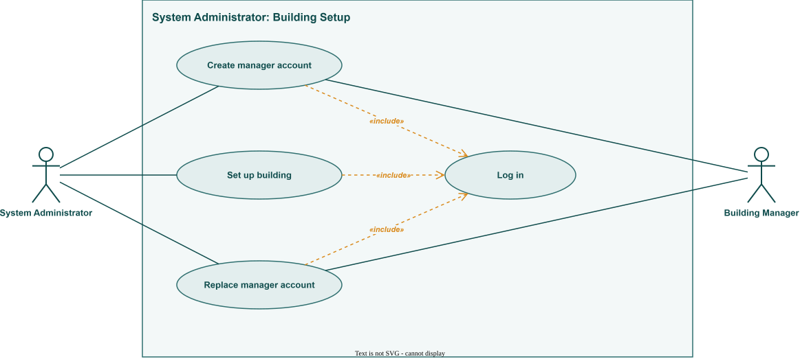

# System Administrator: use cases

This part covers the System Administrator of BariBondhu (Apartment Building Management System). The administrator is a member of the development team who installs the system, sets the building up, and creates or replaces the manager's account. They take no part in running the building and can't open bills, payments, tickets or feedback (ADM-01). IDs such as ADM-01 and BR-15 refer to the SRS.

The diagram is a `.drawio.svg` file in `diagrams/system-administrator/use_case/`. To edit it, open it in draw.io or the VS Code Draw.io Integration extension.

## 1. UML use case diagram

The System Administrator is the primary actor and the Building Manager the secondary actor. Every use case needs the administrator to be logged in, which the diagram shows as «include» Log in. The administrator has no Set new password or Reset password use case, because the account is set up at installation and reset by the development team outside the app.

*Figure A1: System Administrator use cases: Building Setup*

## 2. Use case narratives

The narratives use the Lecture 3 table format described in [SDS.md](../SDS.md#notation).

### UC-ADM01 Log in

| Field | Description |
|---|---|
| **Use case** | UC-ADM01 Log in (ADM-01, BR-14) |
| **Actors** | Primary: System Administrator |
| **Precondition** | The administrator account was created when the system was installed. |
| **Trigger** | The administrator opens BariBondhu while logged out. |
| **Main success scenario** | 1. Administrator enters the username and password. 2. System checks them. 3. System opens the setup screens. |
| **Alternate flows** | 2a. Wrong username or password → error shown, return to step 1. After 5 wrong passwords in a row, this device must wait 15 minutes (BR-14). 3a. Administrator tries to open bills, payments, tickets or feedback → access refused. |
| **Postcondition** | The administrator can use the setup screens only. |
| **Non-functional** | Session ends after 15 minutes idle (NFR-07). Passwords stored only as salted hashes (NFR-04). |

### UC-ADM02 Set up building

| Field | Description |
|---|---|
| **Use case** | UC-ADM02 Set up building (ADM-01) |
| **Actors** | Primary: System Administrator |
| **Precondition** | A new installation. The administrator is logged in («include» Log in). |
| **Trigger** | The administrator opens Building setup. |
| **Main success scenario** | 1. Administrator enters the building name, address, blocks, floors and flat numbers. 2. System checks that each flat number is unique. 3. System creates the flats, and they appear in the manager's flat list. |
| **Alternate flows** | 2a. A flat number is repeated → the System says which one. Nothing is created. |
| **Postcondition** | The building and its flats exist. |
| **Non-functional** | Up to 200 flats per installation (NFR-31). Logged (NFR-27). |

### UC-ADM03 Create manager account

| Field | Description |
|---|---|
| **Use case** | UC-ADM03 Create manager account (ADM-01, BR-15) |
| **Actors** | Primary: System Administrator · Secondary: Building Manager |
| **Precondition** | The building exists and has no active manager. The administrator is logged in («include» Log in). |
| **Trigger** | The administrator opens Manager account and taps Create. |
| **Main success scenario** | 1. Administrator enters the manager's name, phone and email. 2. System creates the account with a generated username and a temporary password. 3. The manager must replace the password at the first log-in (UC-BM02). |
| **Alternate flows** | 2a. A manager account is already active → use Replace manager account (UC-ADM04) instead. |
| **Postcondition** | The manager can log in and run the building. |
| **Non-functional** | Temporary password expires after 7 days (NFR-04). Logged (NFR-27). |

### UC-ADM04 Replace manager account

| Field | Description |
|---|---|
| **Use case** | UC-ADM04 Replace manager account (ADM-01) |
| **Actors** | Primary: System Administrator · Secondary: Building Manager |
| **Precondition** | The manager has left or is unavailable. The administrator is logged in («include» Log in). |
| **Trigger** | The administrator opens Manager account and taps Replace. |
| **Main success scenario** | 1. Administrator deactivates the current manager account. 2. Administrator creates the new manager's account, as in UC-ADM03. 3. The new manager has full access, and all past records are kept. |
| **Alternate flows** | The manager forgot the password and has no email → the administrator issues a new temporary password (BR-15). |
| **Postcondition** | The building has exactly one active manager. |
| **Non-functional** | Past records are kept (NFR-27). The building is never left without a manager (R-14). |

## 3. State diagrams

The administrator changes only the manager's account, whose states are in the Building Manager's Staff account diagram.
