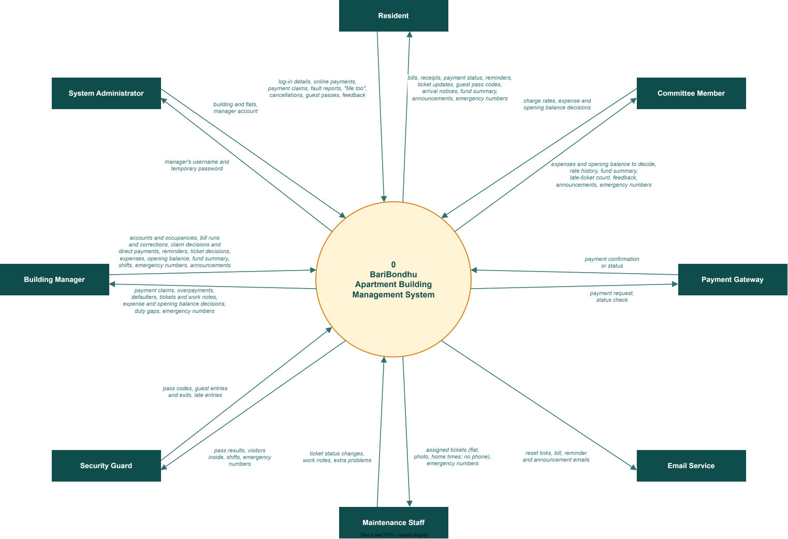

# Data flow diagram

This diagram covers the whole of BariBondhu (Apartment Building Management System). It uses Gane-Sarson symbols: dark rectangles are external entities and the circle is the process. Each arrow carries data one way and is labelled with what it carries. Story IDs, business rules (BR) and non-functional requirements (NFR) refer to the SRS.

The diagram is a `.drawio.svg` file in `diagrams/system/`.

## Level 0 (context diagram)

Level 0 draws the whole system as a single process, numbered 0. It shows the six user roles and the two outside services, and what passes between each of them and the system. Data stores are not shown at this level.

*Figure D1: DFD Level 0 (context diagram)*

| Entity | Sends to the system | Gets from the system |
|---|---|---|
| Resident | log-in details, online payments, payment claims, fault reports, "Me too", cancellations, guest passes, feedback | bills, receipts, payment status, ticket updates, guest pass codes, arrival notices, fund summary, announcements, emergency numbers |
| Building Manager | accounts and occupancies, bill runs and corrections, claim decisions and direct payments, ticket decisions, expenses, shifts, emergency numbers, announcements | payment claims, overpayments, defaulters, tickets and work notes, expense decisions, duty gaps |
| Committee Member | charge rates, expense and opening balance decisions | expenses to decide, rate history, fund summary, late-ticket count, feedback, announcements |
| Security Guard | pass codes, guest entries and exits, late entries | pass results, visitors inside, shifts, emergency numbers |
| Maintenance Staff | ticket status changes, work notes, extra problems | assigned tickets (flat, photo, home times; never a phone number) |
| System Administrator | building and flats, manager account | the manager's username and temporary password |
| Payment Gateway | payment confirmation or status | payment request, status check |
| Email Service | (nothing) | reset links, bill, reminder and announcement emails |
