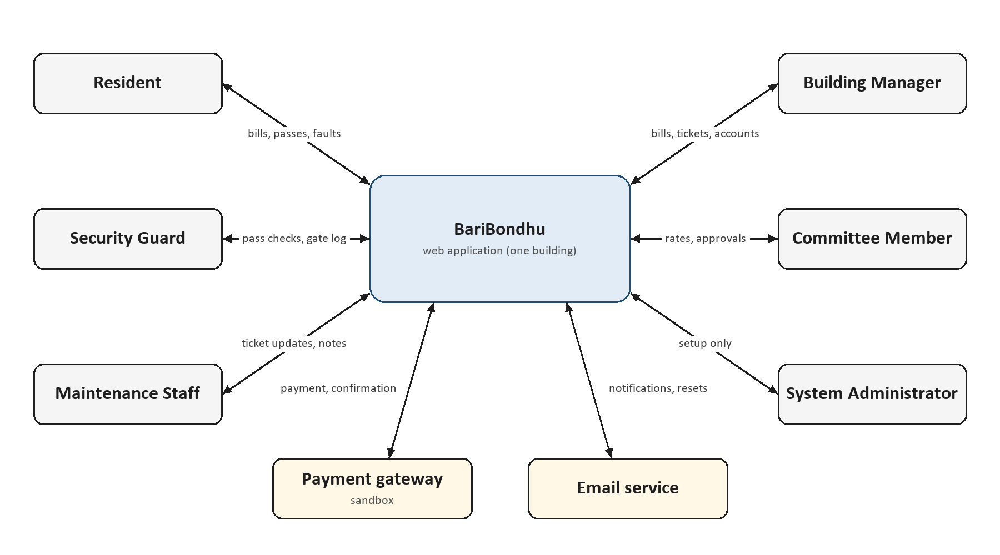

# Software Requirements Specification

**BariBondhu: Apartment Building Management System**

Release 1 · Version 1.6 · 20 November 2026

CSE 451 Software Engineering, Autumn 2026 · Independent University, Bangladesh

Course instructor: Dr. Md. Mushfique Anwar

**Prepared by**

| Team member | ID | Part owned |
|---|---|---|
| Mahir Al Kamal | 2632711 | Resident (RES) |
| Jannatul Ferdus Nishi | 2231385 | Building Manager (BM) |
| Tawhid Moslim | 2311428 | Security Guard (SG) |
| Ayesha Siddiqa | 2211155 | Committee Member (CM) |
| Adika Rahman | 2221975 | Maintenance Staff (MNT) |

**Revision history**

| Version | What changed | Date |
|---|---|---|
| 1.0 | The five user-class drafts merged into one SRS: stories, business rules, NFRs and risks. | 23 Oct 2026 |
| 1.1 | Building Manager and Committee Member review changes. | 25 Oct 2026 |
| 1.2 | Full consistency review; BR-15 (first log-in and password reset) added. | 9 Nov 2026 |
| 1.3 | Moved to Markdown; final team review of move-out, double-payment, guest-pass and night-shift cases. | 15 Nov 2026 |
| 1.4 | Shortened: criteria that repeat a business rule or NFR, most story notes and all "Touches" lines removed; risks and user needs trimmed; 1.3 rewritten as a paragraph; "In scope" table removed; permissions table moved to the SDS design inputs. | 15 Nov 2026 |
| 1.5 | Consistency fixes after the SDS review: optional email on staff and committee accounts (BM-02); the first fund summary is published only after the opening balance is approved (BM-12); total outstanding added to RES-05; R-13 and NFR-07 reworded to match the stories. | 17 Nov 2026 |
| 1.6 | Online payments in Release 1 may use a simulated gateway with the same flow as a real gateway sandbox (sections 1.4, 2, 2.3 and 2.4). | 20 Nov 2026 |

**Contents**

1. [Introduction](#1-introduction): [1.1 Purpose](#11-purpose) · [1.2 Intended Audience](#12-intended-audience) ·
   [1.3 Intended Use](#13-intended-use) · [1.4 Product Scope](#14-product-scope) ·
   [1.5 Risk Definitions](#15-risk-definitions)
2. [Overall Description](#2-overall-description): [2.1 User Classes and Characteristics](#21-user-classes-and-characteristics) ·
   [2.2 User Needs](#22-user-needs) · [2.3 Operating Environment](#23-operating-environment) ·
   [2.4 Constraints](#24-constraints) · [2.5 Assumptions](#25-assumptions)
3. [Requirements](#3-requirements): [3.1 Functional Requirements](#31-functional-requirements) ·
   [3.2 Non-Functional Requirements](#32-non-functional-requirements)

## 1. Introduction

### 1.1 Purpose

This document specifies Release 1 of BariBondhu, a web application for running one apartment building in Dhaka. For each kind of user it says what the system must do and how well, within the limits set out in 2.4. If a behaviour isn't described in this document, it isn't in Release 1.

### 1.2 Intended Audience

| Reader | What they use this document for |
|---|---|
| Development team | Building the system story by story. Section 3.1 is the build list, and the design document (SDS) is drawn from it. |
| Testers | Writing test cases. Every confirmation criterion in 3.1 and every requirement in 3.2 is written so that it can be checked with a pass or fail result. |
| Course instructor | Assessing the completeness and quality of the requirements. |
| Building stakeholders (manager, committee) | Checking that the system matches how the building really runs, before development starts. |

### 1.3 Intended Use

Sections 1 and 2 give the context; section 3 holds the requirements, which the design, the code and the tests are checked against. Every requirement has an ID that never changes: stories start with their class (RES, SG, BM, CM, MNT, ADM), and business rules, non-functional requirements and risks use BR, NFR and R. Stories follow "As a [user], I want [goal], so that [benefit]" with Given / When / Then confirmation criteria, and carry a MoSCoW priority: Must (Release 1 can't ship without it), Should (planned for Release 1) or Could (if time allows).

### 1.4 Product Scope

In most Dhaka apartment buildings, daily running depends on a paper register, phone calls and a WhatsApp group. The manager collects service charges in cash and writes receipts by hand, if there is a receipt at all. At the gate, a guest waits while the guard tries the flat on an intercom that often doesn't work. When the lift stops or a pipe bursts, residents keep phoning the manager to find out whether anyone is on it. Most residents only hear how the building fund was spent once a year, if then.

BariBondhu moves this work into one web app shared by the five groups who live in or run the building: residents, guards, the manager, the committee and maintenance staff.

Goals for Release 1:

- Every payment, online or in cash, ends with a receipt and a record that both the household and the manager can see.
- A guest with a valid pass gets through the gate without the guard calling the flat.
- Each fault has exactly one ticket, and everyone who reported or follows it can see its status until it is closed.
- Residents and the committee can see each month's income, spending and balance.
- Nothing depends on the app alone: flats that pay in cash and visitors who use the intercom are still handled.

**Not included in Release 1**

We discussed these and left them out of Release 1 on purpose:

- Separate logins for each family member, and registering maids, drivers or tutors.
- Approving walk-in visitors and deliveries from the resident's phone. Walk-ins keep using the intercom.
- Parcel tracking and parcel collection management.
- Read receipts on announcements, and polls or voting.
- Residents confirming or rejecting a repair. The manager closes tickets (BM-07).
- Raising bill disputes through the platform. Residents will need to contact the manager directly.
- Partial or advance payments, and different charge rates for different flats.
- Two-person approval for large expenses, and budgets or forecasts.
- SMS, an SOS button, native Android or iOS apps, and more than one building per installation.
- Real payments. Release 1 runs only against a payment-gateway sandbox or a simulated gateway with the same flow.

### 1.5 Risk Definitions

Each risk below is rated for likelihood and impact (H, M or L for High, Medium or Low), with the requirements that reduce it.

R-03, R-04, R-08, R-10, R-15 and R-16 were dropped in version 1.4 to shorten the document. Their IDs are not reused.

| ID | Risk | Likely | Impact | How we handle it |
|---|---|---|---|---|
| R-01 | A bill shows Paid but the money never arrived. | M | H | Paid only on gateway server confirmation or manager acceptance (BR-02, NFR-15); cash claims checked by the manager (BM-04). |
| R-02 | A resident is charged twice for one bill. | M | H | Only one payment flow per bill at a time; Pay is disabled while a payment is pending; a late gateway payment on a settled bill is flagged as an overpayment (BR-03, BR-04, RES-01, BM-04). |
| R-05 | A guest pass is forwarded or reused to let in strangers. | M | M | Visit window, guest count, cancel, and unique random codes (RES-03, SG-02, NFR-08). |
| R-06 | Private data leaks: phone numbers to staff, one flat's bills to another, or a previous tenant's history to the new one. | M | H | Role and flat-level access checks, occupancy periods, totals-only fund view (NFR-06, NFR-10, NFR-12, NFR-13, BM-02). |
| R-07 | Someone in danger (fire, gas, lift) waits in a ticket queue. | L | H | Emergency categories show 999 and the building numbers first, then log an Urgent ticket (RES-02, BM-10, SG-06, NFR-16). |
| R-09 | An account is taken over, or someone keeps a flat locked out by entering wrong passwords. | M | M | Hashed passwords, non-guessable usernames, and wrong-password delays per device instead of per account (NFR-04, NFR-05). |
| R-11 | Load-shedding cuts the gate's internet, so the guard can't check passes. | H | M | Fallback to intercom and paper register, then visits entered later (SG-03, NFR-21). |
| R-12 | Spending counts before the committee approves it, or a rate changes with no record of who changed it. | L | H | Only Approved expenses count; every rate change stores who, when, old and new value and the meeting date (CM-01, CM-02, NFR-27). |
| R-13 | A fault ticket, or a problem a maintenance worker found during a repair, sits with nobody assigned or stalls after assignment. | M | M | The manager sees late and overdue tickets highlighted, and the committee dashboard counts the late ones. Problems found by staff join the same ticket list (BM-06, MNT-05, CM-04, NFR-16). |
| R-14 | The manager leaves or is unavailable and nobody can administer the building. | L | H | The system administrator can create, deactivate and replace the manager account (ADM-01). |

## 2. Overall Description

BariBondhu is a new product; the building has no system today that it replaces. People open it in the browser on a phone or laptop, and can add it to the phone's home screen like an app.

One installation serves one building. It uses two outside services: a payment-gateway sandbox (or a simulated gateway with the same flow) for online payments, and an email service for notifications and password resets.

_Figure 1. System context: the six user roles and the two external services._

### 2.1 User Classes and Characteristics

Five user classes use BariBondhu day to day. A sixth, the system administrator, only sets the system up and creates or replaces the manager's account.

Residents are the primary users. The manager uses the system most often and links all the other classes. The [permissions table](../sds/design-inputs-from-srs.md#role-permissions) in the SDS design inputs lists what each role can do.

| Class | Technical skill | Device | Language | How often |
|---|---|---|---|---|
| Resident | Very mixed: students to elderly WhatsApp-only users | Own Android phone | Bangla preferred by many, English | Monthly bills, weekly guests, faults now and then |
| Security Guard | Low; limited English typing | Shared Android phone or tablet at the gate | Bangla | Every shift, many times an hour |
| Building Manager | Average | Phone, sometimes a laptop | Bangla and English | Many times a day |
| Committee Member | Varies widely | Own phone (most) or laptop | Bangla or English | About once a month |
| Maintenance Staff | Basic smartphone use | Own phone | Bangla | Daily during repair work |
| System Administrator | High (development team) | Laptop | English | Setup and rare support |

#### 2.1.1 Resident

Flat owners and tenants who live in the building. Both pay the service charge, so the system treats them the same. Each household shares one account for as long as it lives in the flat (its occupancy). When it moves out, the manager ends the occupancy, and the next household starts with a new account and an empty history. Some flats will not use the app at all, so paying the manager in cash and the intercom must keep working.

#### 2.1.2 Security Guard

Building staff who work the gate in shifts. They check guest passes and record when guests arrive and leave. Each guard logs in with a personal account, so every gate record shows who made it. Few guards type English comfortably and a busy gate leaves no time for forms, so the guard screens are in Bangla and need almost no typing.

#### 2.1.3 Building Manager

Paid staff who run the building every day: household and staff accounts, monthly bills, payment claims, fault tickets, guard shifts, expenses, the fund summary, emergency numbers and announcements. The manager connects all user groups and is the only person, apart from the household itself, who can view residents' phone numbers.

#### 2.1.4 Committee Member

Elected flat owners who oversee building finances. They can set service charge rates, approve or reject expenses, review fund summaries and read resident feedback. At least one member records meeting decisions in the system. All committee members have the same permissions in Release 1.

#### 2.1.5 Maintenance Staff

Electricians, plumbers and other technicians responsible for building repairs. They can view and update assigned tickets, add work notes and report additional issues. They cannot assign or close tickets and communicate with residents through the manager.

#### 2.1.6 System Administrator

A development team member responsible for installing the system and creating the initial manager account. They can also replace the manager account when needed but cannot access daily building records such as bills, payments or maintenance tickets.

### 2.2 User Needs

For each class, the table compares how things work today with what goes wrong. The last column names the stories that answer each need.

| Class | How it works today | Problem | What they need | Stories |
|---|---|---|---|---|
| Resident | Cash to the manager and a paper register; intercom calls; phoning the manager about faults; notices on the board; accounts once a year, if at all | No proof of payment; guests wait at the gate; no record or status for faults; notices missed; no idea where the money goes | An itemised bill paid online or recorded as cash, with a receipt; guest passes; fault reports they can follow; announcements; a monthly fund summary and service ratings | RES-01 to RES-05, RES-07, RES-08 |
| Guard | Intercom calls and a paper visitor register; shifts told verbally; emergency numbers on paper | Delays and incomplete records; unsure of duty times; time lost finding numbers | Check a pass, record entry and exit, see who is inside; see own shift; open emergency numbers in two taps | SG-02 to SG-07 |
| Manager | Paper register for dues; faults passed on by phone; contacts on paper; notice board; accounts shown once a year | Disputes over who paid; no record of faults or extra problems; out-of-date contacts and duty times; notices missed | Itemised bills and claim checks; one ticket list; one place for accounts, shifts and emergency numbers; announcements; expenses and a monthly summary | BM-02 to BM-12 |
| Committee | Rates and approvals agreed on paper or in chat; complaints in person; accounts heard only at the meeting | No record of decisions; spending approved informally; residents fear being named; nothing to check beforehand | Rates with full history; approve or reject each expense with its receipt; anonymous feedback; fund figures and late tickets before the meeting | CM-01 to CM-04 |
| Maintenance | Jobs passed on by phone; work and extra problems reported verbally | Jobs missed; no record of what was done; extra problems forgotten | A list of assigned tickets with details; status updates and notes; extra problems reported as new tickets | MNT-01 to MNT-05 |
| All classes | Paper registers and group chats with no sign-in | Anyone can claim a payment, a decision or a gate entry; nobody knows who recorded what | A personal account for each role (one per household for residents), so every record shows who made it and each user sees only their own part | RES-06, SG-01, BM-01, CM-05, MNT-06, ADM-01 |

### 2.3 Operating Environment

| Item | Environment |
|---|---|
| Application type | Responsive web application, installable to the home screen as a progressive web app (PWA). No native app. |
| Resident, committee, maintenance | Their own phones (mostly Android, Chrome browser); some committee members on a laptop browser. |
| Security guard | One shared Android phone or tablet at the gate, with a rear camera for scanning QR codes, kept charged on mains power with a power bank for load-shedding. |
| Building manager | Own phone and an office laptop. |
| Network | Mobile data or home Wi-Fi. Load-shedding often takes Wi-Fi down, so the system must work on slow mobile data. |
| Server side | Cloud hosting with a relational database, backed up every hour (NFR-20); an email service; a payment-gateway sandbox or a simulated gateway with the same flow. |
| Locale | Bangladesh: time zone Asia/Dhaka, currency BDT (৳), Bangla and English. |

### 2.4 Constraints

- Payments go through a payment-gateway sandbox or a simulated gateway with the same flow. No real money moves in Release 1.
- No SMS. Notifications are in-app (with web push where the browser allows it) and by email.
- Web application only; it must run in the browsers listed in NFR-28.
- All interface text must be kept up to date in both Bangla and English.
- One installation serves one building of up to 200 flats.
- Release 1 is built by a student team within one semester, on free or low-cost hosting.
- Records covered by the audit log are kept for at least 5 years (NFR-27).

### 2.5 Assumptions

Any of these could turn out to be wrong. If one does, the requirements that depend on it must be reviewed.

- Every flat that uses the app has at least one person with a smartphone and internet access. Flats that don't can pay the manager in cash, and the manager records it (BM-04).
- Bills are per flat, and the household living there pays. Owners living abroad or with an empty flat pay the manager directly, who records the payment.
- All flats pay the same rate for each charge. Rates that depend on flat size are out of scope.
- The manager ends an occupancy when a household moves out, and opens a new account for the next household.
- The system administrator (development team) sets up the building and the manager account (ADM-01).
- At least one committee member uses the app and enters the committee's decisions after each meeting.
- The committee meets at least once a month to decide rates and expenses.
- Bangladesh's national emergency number 999 reaches fire, police and ambulance. The building also has a staffed guard-desk number and a manager number.
- Repairs inside a flat are done by building staff; any cost is settled between the flat and the manager outside the app.
- Receipt and slip photos taken on a phone are clear enough to read the amount and date.
- Some residents have no email address. For them, the manager resets passwords (BM-02).
- The gate device stays powered during load-shedding (power bank or backup supply).

## 3. Requirements

### 3.1 Functional Requirements

Functional requirements are written as user stories with confirmation criteria. Rules that several stories share are stated once as business rules (3.1.1) and referred to by ID.

#### 3.1.1 Business rules

| ID | Rule | Used by |
|---|---|---|
| BR-01 | All dates and times use the Asia/Dhaka time zone. All amounts are in BDT (৳) with two decimal places. | All |
| BR-02 | A bill becomes Paid only when the payment gateway confirms the payment through its server-to-server notification, when the manager accepts a claim or records a payment received directly, or when a correction brings its total to ৳0 or below as set out in BR-07. Nothing the resident's phone reports can make a bill Paid. | RES-01, RES-04, BM-03, BM-04 |
| BR-03 | A bill can be in only one payment flow at a time. While it is Payment pending, cash claims are blocked; while it is Awaiting verification, online payment is blocked. The manager cannot record a direct payment for a bill that is Payment pending; for a bill that is Awaiting verification, the manager decides the claim instead. | RES-01, RES-04, BM-04 |
| BR-04 | If a bill has been Payment pending for 30 minutes with no confirmation, the system asks the gateway for the payment status. If the gateway has no successful payment, the bill returns to Unpaid. A confirmation that arrives later makes the bill Paid if it is still Unpaid or Payment pending. If the bill is by then Paid, Awaiting verification or Carried forward, the money is recorded and flagged to the manager as an overpayment, which the manager refunds outside the app. | RES-01, BM-04 |
| BR-05 | When a new month's bills are made, any earlier bill of the same occupancy that is still Unpaid is closed as Carried forward, and its amount appears as one "Carried forward" line on the new bill. A debt is therefore normally owed on one open bill. Unpaid bills of an ended occupancy are never carried onto the next household's bill; they stay Unpaid and are settled with the manager (BM-02, BM-04). If a bill returns to Unpaid after a newer bill of the same occupancy exists (a rejected claim or a timed-out payment), its amount moves onto the newest bill as a Carried forward line, but only while that bill is still Unpaid. If the newest bill is already Paid, Payment pending or Awaiting verification, it is not changed; the older bill stays Unpaid, can be paid on its own, and is carried forward at the next bill run. | BM-02, BM-03, BM-04, BM-05, RES-01, RES-04 |
| BR-06 | Partial payments are not supported. A payment or claim must equal the bill total. | RES-04, BM-04 |
| BR-07 | A Paid bill cannot be edited. A mistake on a Paid bill is fixed by an adjustment line (positive or negative) on the next month's bill, with a reason. An Unpaid bill can be corrected with a reason. Bills are never deleted. A bill whose total comes to ৳0 becomes Paid with no payment. A bill whose total falls below ৳0 becomes Paid and the difference appears as a credit line on the household's next bill; for an ended occupancy the manager refunds it outside the app. | BM-03 |
| BR-08 | A flat appears on the defaulters list when it has an Unpaid bill past its due date. Bills in Awaiting verification or Payment pending do not count until they are decided. | BM-05, RES-04 |
| BR-09 | Each household's bills, payments, guest passes, tickets and feedback belong to its occupancy. A new occupancy cannot see an earlier one's records. The manager can see all of them. A bill made while a flat has no active occupancy belongs to the flat; only the manager sees it, and the owner pays it to the manager (BM-04). | BM-02, BM-03, BM-04, BM-05, RES-06 |
| BR-10 | The monthly fund summary counts payments by the date they were confirmed and expenses by their expense date, and only Approved expenses. Opening balance = the previous month's closing balance; the first month's opening balance is entered by the manager and approved by the committee. | BM-12, CM-04, RES-05 |
| BR-11 | A guest pass is valid from its start date-time to its end date-time (at most 24 hours; it may cross midnight). Codes are 6 random digits, unique among all passes that are Scheduled, Active or Partly used. Cancelling or expiring a pass stops new entries only; guests already inside can always be checked out. A household's passes are cancelled when its occupancy ends. | RES-03, SG-02, SG-04, BM-02 |
| BR-12 | Emergency screens always show 999 (national emergency service) first, then the guard-desk and manager numbers. 999 cannot be edited or removed; the building numbers cannot be saved empty. | RES-02, SG-06, BM-10 |
| BR-13 | Common-area faults are reported against a fixed list of places (for example Lift 1, Lift 2, water pump, generator, roof, stairs, parking, lobby, other) that the manager can extend. A "Me too" match is the same place and category with a ticket that is not Closed, Cancelled, Duplicate or Won't fix. | RES-02, BM-06 |
| BR-14 | Wrong-password protection works per device, not per account: after 5 wrong passwords in a row from one browser, that browser must wait 15 minutes. Logins from other devices are not affected, so nobody can lock another person out. The shared gate device counts wrong passwords per username instead, so one guard's mistakes, or a stranger's, never block another guard from logging in at the gate. | All log-in stories |
| BR-15 | Every new account gets a generated username and a temporary password. At the first log-in the user must replace it with a password of at least 8 characters. Forgot password sends a reset link, valid for 30 minutes, to the account's email; a user with no email asks the manager for a new temporary password (BM-02). The administrator does the same for the manager account (ADM-01). | All log-in stories, BM-02, ADM-01 |

#### 3.1.2 Resident (RES)

##### RES-01 · See and pay my monthly bill · Must

_As a resident, I want to see my monthly bill broken down by charge and pay it online, so that I know what I'm paying for and have proof without handing cash to anyone._

**Confirmation**

- Given my flat has a bill for the month, when I open Dues, then I see each charge (service, generator, water) with its rate, any Carried forward or adjustment line, the total and the due date.
- Given I tap Pay and go to the gateway, when the gateway hasn't confirmed yet, then the bill shows Payment pending and both Pay and Record cash payment are disabled (BR-03).
- Given the gateway confirms the payment while the bill is Payment pending or Unpaid, when I open Dues, even if I closed the app halfway, then the bill shows Paid and I can download a receipt with a receipt number and the gateway's transaction ID.
- Given the bill has been Payment pending for 30 minutes and the gateway reports no successful payment, when the system re-checks, then the bill goes back to Unpaid and I can pay again (BR-04).
- Given the payment fails or I cancel it, when I come back to the app, then the bill stays Unpaid and I see the reason the gateway gave.
- Given my bill is past its due date, when the manager sends a reminder, then I get a notification that opens the bill.

##### RES-02 · Report a fault · Must

_As a resident, I want to report a fault and say whether it's inside my flat or in a common area, so that the right person fixes it without me calling the manager again and again._

**Confirmation**

- Given I pick Inside my flat, when I submit a category, a short title, a description, an optional photo and the times someone is home, then a ticket is created as Reported and the manager is notified.
- Given I pick Common area and choose a place from the list, when an open ticket already exists for that place and category (BR-13), then I see it and can tap "Me too" to follow it instead of creating a duplicate.
- Given I pick an emergency (fire, gas smell, someone stuck in a lift), when I select it, then the app shows 999 first and then the guard-desk and manager numbers, each with a one-tap Call button, before anything else (BR-12).
- Given I have seen the emergency numbers, when I tap "Log it for repair", then an Urgent ticket is created and the manager is notified.
- Given a ticket I reported or follow changes status, when the change is saved, then I get a notification.
- Given my ticket is still Reported and nobody else follows it, when I cancel it, then its status becomes Cancelled and the manager is notified. Once a ticket is Assigned, only the manager can close it.
- Given other residents have tapped "Me too" on my ticket, when I cancel it, then I only stop following it, and the ticket stays open for them.
- Given the description is empty, when I submit, then I see "Describe the problem" and nothing is created.

##### RES-03 · Pre-approve guests · Must

_As a resident, I want to create a pass for guests I'm expecting and share it with them, so that the guard lets them in without calling me on the intercom._

**Confirmation**

- Given I enter the guest's name, how many people are coming (1 to 20), and a start and end date-time no more than 24 hours apart, when I save, then I get a 6-digit code and a matching QR code (BR-11), and I can share either one from my phone.
- Given the end time is before the start time, more than 24 hours after it, or already past, when I save, then I see "Check the visit times" and no pass is created.
- Given the pass is for 4 people, when the guard has checked in 4 guests, then the pass shows Fully used and the guard can't check anyone else in on it.
- Given my plans change, when I cancel the pass, then the code stops working for new entries at the gate immediately; guests already inside can still be checked out (BR-11).
- Given my guests are checked in, when the guard records it, then I get a notification with the number of guests who arrived.
- Given the end time has passed, when anyone checks the code, then the pass shows Expired.

##### RES-04 · Record a cash or bank payment · Should

_As a resident, I want to record that I paid in cash or by bank transfer, so that my bill doesn't show as unpaid while the manager checks it._

**Confirmation**

- Given my bill is Unpaid and no online payment is pending, when I enter the amount, date, method and an optional photo of the slip, then the bill shows Awaiting verification and the manager is notified.
- Given the amount I enter is not the bill total, when I submit, then I see "The amount must match the bill total (৳ total). Partial payments aren't supported." and nothing is saved (BR-06).
- Given the payment date is in the future, when I submit, then I see "Check the payment date" and nothing is saved.
- Given the manager accepts the claim, when they confirm, then the bill shows Paid and I can download a receipt.
- Given the manager rejects the claim with a reason, when I open Dues, then the bill is Unpaid again and I see the reason. If a newer bill exists and is still Unpaid, the amount moves onto it as a Carried forward line; otherwise the old bill stays Unpaid and I can pay it on its own (BR-05).

##### RES-05 · See how the building fund is spent · Could

_As a resident, I want a monthly summary of what the building collected and spent, so that I can see where my service charge goes._

**Confirmation**

- Given the manager has published a month's summary, when I open Fund summary, then I see the opening balance, total collected, total spent by category (repair, salary, utility, other), the closing balance and the total outstanding (BR-10).
- Given an expense is still Waiting for approval or was Rejected, when I view the summary, then it isn't counted.
- Given this month's summary hasn't been published yet, when I open Fund summary, then I see the last published month and a note that this month isn't ready.

##### RES-06 · Log in to my flat's account · Must

_As a resident, I want to log in to my household's account, so that only my household can see our bills, guest passes and tickets._

**Confirmation**

- Given the manager has created our account, when I enter the username the manager gave us and our password, then I see the resident home screen.
- Given I log in for the first time with a temporary password, when I sign in, then I must set a new password of at least 8 characters before continuing.
- Given 5 wrong passwords in a row from my phone, when I try again, then my phone must wait 15 minutes, and I see how long is left (BR-14).
- Given I've forgotten the password and our account has an email address, when I tap Forgot password, then a reset link valid for 30 minutes goes to that email. If there is no email, the screen tells me to ask the manager.

##### RES-07 · Give feedback on building services · Could

_As a resident, I want to rate the building's services and leave a comment, so that the committee knows what's working and what isn't._

**Confirmation**

- Given I pick a service (cleaning, security, maintenance, lift or other), a rating from 1 to 5 and an optional comment of up to 500 characters, when I submit, then it's saved and I see a thank-you message.
- Given I tick Send anonymously, when the committee reads my feedback, then they see neither my flat number nor the account name.
- Given I already gave feedback on the same service this month, when I submit again, then my earlier feedback is replaced, not added to.
- Given I haven't picked a rating, when I submit, then I see "Pick a rating" and nothing is saved.

##### RES-08 · Read building announcements · Should

_As a resident, I want to read the manager's announcements in the app, so that I hear about water cuts, power cuts and building events even when I miss the notice board._

**Confirmation**

- Given the manager sends an announcement to all residents or to my block or floor, when I open Announcements, then I see its title, message and date, and I get an in-app and email notification.
- Given an announcement is marked Urgent, when I open the app, then it stays at the top of my home screen until its expiry time.
- Given the manager edits or removes an announcement, when I open Announcements, then I see the new version, or it's gone.
- Given an announcement was sent only to another block, when I open Announcements, then I don't see it.

#### 3.1.3 Security Guard (SG)

##### SG-01 · Log in to the guard screens · Must

_As a security guard, I want to log in with my own guard account, so that only authorised staff use the gate functions and every gate record shows who made it._

**Confirmation**

- Given I enter the correct username and password for an active guard account, when I log in, then I see the guard dashboard.
- Given 5 wrong passwords in a row for my username on the gate device, when I try again, then my username must wait 15 minutes on that device, and other guards can still log in (BR-14).
- Given the device has been idle for 15 minutes, when I touch it, then I must log in again.
- Given the previous guard's shift has ended, when I tap Switch guard, then they are logged out and I can log in with my own account.

##### SG-02 · Check a guest pass · Must

_As a security guard, I want to type or scan a resident's guest-pass code, so that I can tell straight away whether the guest is approved to enter._

**Confirmation**

- Given a code that is valid now (BR-11), when I check it, then I see the guest name, the flat, the approved guest count and how many can still enter.
- Given a code that is expired, cancelled or not yet valid, when I check it, then check-in is refused and I see "Pass not valid" with the reason (Expired, Cancelled or "Valid from [time]").
- Given a code that matches no pass, when I check it, then I see "No pass with this code".
- Given the pass is Fully used, when I check it, then I see Fully used and check-in is not offered.

##### SG-03 · Record guest entry · Must

_As a security guard, I want to check guests in against a valid pass, so that the system records how many people entered for which flat, and when._

**Confirmation**

- Given a valid pass with guests remaining, when I enter how many are arriving now (1 up to the number remaining) and confirm, then the entry time, guest count and my account are saved and the pass usage is updated.
- Given the check-in is saved, when the record is stored, then the resident gets the notification described in RES-03.
- Given I enter more guests than remain on the pass, when I confirm, then check-in is refused and I see how many remain.
- Given the device can't reach the server, when I try to check a pass or confirm entry, then within 5 seconds I see "No connection: use the intercom and paper register", and nothing is shown as saved.
- Given the connection is back, when I enter a visit from the paper register with its real time, then it is saved and marked Entered later.

##### SG-04 · Record guest exit · Must

_As a security guard, I want to record when guests leave, so that the list of visitors inside stays accurate._

**Confirmation**

- Given a pass has guests inside, when I enter how many are leaving and confirm, then the exit time, count and my account are saved.
- Given all guests on a pass have left, when the exit is saved, then the pass no longer appears in Visitors inside.
- Given a pass has nobody inside, when I try to record an exit, then I see "No guests from this pass are inside" and nothing is saved.
- Given a pass was cancelled or has expired while its guests are inside, when I record their exit, then it is saved as normal (BR-11).

##### SG-05 · See my shift · Should

_As a security guard, I want to see my assigned shifts, so that I know when I'm on duty._

**Confirmation**

- Given the manager has assigned me shifts, when I open Duty, then I see the start and end date-time of each of my shifts for the next 7 days, including night shifts that cross midnight.
- Given no shift of mine covers any part of today, when I open Duty, then I see "No shift today".
- Given I am a guard, when I view Duty, then I cannot create, edit or swap shifts.

##### SG-06 · Open emergency numbers · Must

_As a security guard, I want to reach the emergency numbers fast, so that I don't lose time during a fire, gas leak or lift emergency._

**Confirmation**

- Given I am on any guard screen, when I tap Emergency, then within 2 taps I see 999 first and then the guard-desk and manager numbers, each with a Call button (BR-12).
- Given the manager changes a number, when I open or refresh the screen, then I see the new number.
- Given the gate device has lost its connection, when I tap Emergency, then 999 and the last loaded building numbers still show and can be called.

##### SG-07 · See visitors inside · Should

_As a security guard, I want a list of pass guests who are inside the building, so that I can answer enquiries and know who still has to leave._

**Confirmation**

- Given guests have entered and not all have left, when I open Visitors inside, then I see each pass with the guest name, flat, number inside and entry time.
- Given a pass's end time has passed and guests from it are still inside, when I view the list, then that pass is highlighted as Overstayed.

#### 3.1.4 Building Manager (BM)

##### BM-01 · Log in to the manager screens · Must

_As a building manager, I want to log in with my own account, so that only I can use the manager screens._

**Confirmation**

- Given I enter the right username and password, when I log in, then I see the manager dashboard.
- Given 5 wrong passwords in a row from one device, when I try again, then that device must wait 15 minutes, and I see how long is left (BR-14).

##### BM-02 · Manage accounts and occupancies · Must

_As a building manager, I want to add, edit and deactivate flat, guard, maintenance and committee accounts, so that everyone has the right access and the contact list stays correct._

**Confirmation**

- Given I pick a flat and enter the occupant name, occupancy type (owner or tenant), start date, phone and an optional email, when I save, then a household account is created with a generated username (not the flat number) and a temporary password.
- Given the flat already has an active occupancy, when I try to add another, then I see "End the current occupancy first" and nothing is created.
- Given the household has a bill that is Payment pending or Awaiting verification, when I try to end its occupancy, then I see "Settle the payment in progress first" and nothing changes.
- Given a household is moving out, when I end its occupancy, then its account is deactivated, its guest passes are cancelled, its records are kept, and the flat is ready for a new occupancy with an empty history (BR-09). If it still has Unpaid bills, I must enter a note on how they will be settled.
- Given I create a guard, maintenance or committee account with name, phone, role and an optional email, when I save, then it gets a generated username and temporary password.
- Given I change a resident's phone number, email or flat details, when I save, then the new details show straight away and the change is logged (NFR-27).
- Given a user has forgotten the password and has no email, when I reset it, then a new temporary password is issued and must be changed at first login.
- Given I deactivate any account, when that person tries to log in, then they are refused, and their past bills, tickets and committee decisions are kept.
- Given a maintenance staff member still has tickets that are Assigned, In progress or On hold, when I try to deactivate them, then I see "Reassign their open tickets first" and nothing changes.
- Given I deactivate a guard, when the account is saved, then their future shifts are removed and the gaps show in the duty list (BM-09).
- Given I try to deactivate my own manager account, when I confirm, then the system refuses; only the administrator can replace the manager (ADM-01).

##### BM-03 · Make monthly bills · Must

_As a building manager, I want to make every flat's monthly bill from the committee's rates, so that residents can see what they owe and why._

**Confirmation**

- Given the committee has set rates, when I run the bills for a month with a due date, then every flat (occupied or vacant) gets one bill with each charge and its rate, residents see the same total and due date in their app, and each household gets an in-app and email notification.
- Given a household has an Unpaid bill from an earlier month, when the new bills are made, then the old bill becomes Carried forward and its amount appears as one line on the new bill (BR-05).
- Given the bills for a month already exist, when I try to run them again, then I see "Bills for this month already exist" and nothing is created.
- Given no charge rates have been set, or the due date is before the first day of the billing month, when I run the bills, then I see "Ask the committee to set the charge rates first" or "Check the due date" and nothing is created.
- Given an Unpaid bill is wrong, when I correct it, then I must give a reason and the resident is notified. A Paid bill can only be corrected by an adjustment line on next month's bill, and no bill can be deleted (BR-07).

##### BM-04 · Check and record payments · Must

_As a building manager, I want to accept or reject payments that residents record, and record payments handed to me directly, so that a bill shows Paid only when the money has really arrived._

**Confirmation**

- Given a resident has recorded a payment, when I open Claims, then I see the flat, amount, date, method and slip photo, and the bill shows Awaiting verification.
- Given I accept a claim, when I confirm, then the bill shows Paid and the resident can download a receipt.
- Given I reject a claim, when I enter a reason and confirm, then the bill returns to Unpaid and the resident sees the reason.
- Given I try to reject a claim without a reason, when I confirm, then I see "Write a reason" and nothing changes.
- Given a flat pays me in cash or by bank and has not recorded it in the app, when I record the payment for the full bill total, then the bill shows Paid and a receipt is available to the flat (BR-06).
- Given a bill is Payment pending or Awaiting verification, when I try to record a direct payment, then I see "This bill already has a payment in progress" and nothing is saved (BR-03).
- Given a gateway payment arrives for a bill that is already Paid, Awaiting verification or Carried forward, when I open Claims, then I see it flagged as an overpayment, and I mark it Refunded once the money has been returned outside the app (BR-04).

##### BM-05 · See unpaid dues and send reminders · Should

_As a building manager, I want to see which flats haven't paid and remind them, so that I don't have to phone each one._

**Confirmation**

- Given bills are past their due date, when I open Defaulters, then I see each flat with an Unpaid bill, the amount and how many days late it is (BR-08).
- Given a bill is Awaiting verification or Payment pending, when the due date passes, then that flat is not on the list until it is decided.
- Given I select late flats, when I send a reminder, then each gets an in-app and email reminder. A flat can get at most one reminder per bill every 7 days; extra attempts are refused with the date of the last reminder.
- Given a late bill belongs to an ended occupancy or a vacant flat, when I view Defaulters, then it is listed but no reminder can be sent; I follow it up outside the app, and the flat's current household is never reminded of it (BR-09).

##### BM-06 · Assign fault tickets · Must

_As a building manager, I want all fault tickets in one list and to give each one to a maintenance staff member, so that the right person fixes it on time._

**Confirmation**

- Given tickets exist, when I open Tickets, then I see each with its title, category, place, description, photo, home times, status and, for common areas, how many residents tapped "Me too".
- Given a maintenance worker reported an extra problem during a repair (MNT-05), when I open Tickets, then I see it marked Found by staff with its description and place, and I assign it like any other ticket.
- Given I choose a staff member, a priority (Urgent, High or Normal), a due date and any instructions, when I assign, then the status becomes Assigned and the staff member, the reporter and all followers are notified.
- Given I haven't chosen a staff member or a due date, when I assign, then I see "Choose a staff member and a due date" and the ticket stays Reported.
- Given a ticket has been Reported for more than 24 hours (1 hour if Urgent) with nobody assigned, when I open the list, then it is highlighted as late and it is counted on the committee dashboard (CM-04).
- Given an Assigned, In progress or On hold ticket is past its due date, when I open the list, then it is highlighted as overdue.
- Given a ticket repeats an open one or won't be fixed, when I mark it Duplicate (linking the original) or Won't fix with a reason, then the reporter and followers are notified with the reason. For a Duplicate, they all follow the original ticket from then on.

##### BM-07 · Follow and close tickets · Must

_As a building manager, I want to see status changes and work notes from maintenance staff and close finished tickets, so that I know the work is really done._

**Confirmation**

- Given a staff member changes a ticket to In progress, On hold or Fixed, when I open it, then I see the change, the time and any work notes.
- Given a ticket is Fixed, when I confirm it, then it becomes Closed and the reporter and followers are notified.
- Given a ticket is Fixed but the repair didn't work, when I reopen it with a reason, then it goes back to Assigned and the staff member is notified. A Closed ticket cannot be reopened; a new fault is reported as a new ticket.

**Note:** Only the manager closes or reopens tickets. Maintenance staff cannot.

##### BM-08 · Record building expenses · Must

_As a building manager, I want to record each expense with a category and receipt, so that the committee can approve it and residents can see where the money goes._

**Confirmation**

- Given I enter the amount, expense date, category (repair, salary, utility or other), a description and an optional receipt photo, when I save, then the expense is Waiting for approval.
- Given the expense date is in the future, when I save, then I see "Check the expense date" and nothing is saved.
- Given an expense is still Waiting for approval, when I edit it, then the change is saved with a note.
- Given the committee rejected an expense, when I open it, then I see the reason and can resubmit a corrected version, which goes back to Waiting for approval.
- Given an expense is Approved, when I need to fix it, then I cannot edit or delete it; I add a correcting expense (which may be negative) that links to the original and needs approval.

##### BM-09 · Plan guard shifts · Should

_As a building manager, I want to give each guard a shift, so that the gate is always covered and I know who is on duty._

**Confirmation**

- Given I pick a guard and a start and end date-time (a night shift may end the next day), when I save, then the shift appears in the duty list and on the guard's Duty screen.
- Given the new shift overlaps another shift of the same guard, when I save, then I see "This guard already has a shift then" and nothing is saved.
- Given the end is not after the start, or is more than 24 hours after it, when I save, then I see "Check the shift times" and nothing is saved.
- Given there are hours in the next 7 days with no guard on duty, when I open the duty list, then those gaps are highlighted.

##### BM-10 · Keep emergency numbers up to date · Must

_As a building manager, I want to set the guard-desk and manager emergency numbers, so that residents, guards and staff can call the right person straight away during a fire, a gas leak or a lift emergency._

**Confirmation**

- Given I change a number, when I save, then every user sees the new number the next time they open or refresh the emergency screen.
- Given I leave a number empty or enter something that isn't a Bangladeshi phone number (9 to 11 digits), when I save, then I see "Enter a valid phone number" and nothing is saved (BR-12).

##### BM-11 · Send announcements · Should

_As a building manager, I want to send announcements, so that residents and committee members hear about building events and water or power cuts._

**Confirmation**

- Given I write a title and message (in Bangla or English) and choose all residents, one block or one floor, when I send it, then it appears in their app and they get an in-app and email notification. Announcements to all residents also reach committee members.
- Given I mark it Urgent (a water or power cut, say), when I send it, then I must set an expiry date-time in the future (otherwise I see "Check the expiry time"), and it stays at the top of the resident's home screen until then.
- Given I edit or remove an announcement, when I save, then residents see the new version or it disappears.
- Given the title or message is empty, when I send, then I see "Write a message" and nothing is sent.

##### BM-12 · Publish the monthly fund summary · Should

_As a building manager, I want to publish each month's summary of money collected and spent, so that the committee and residents can see where the service charge goes._

**Confirmation**

- Given the month has ended, when I publish its summary, then it shows the opening balance, total collected, total spent by category, the closing balance and the total outstanding (BR-10).
- Given the month hasn't ended yet, when I try to publish its summary, then I see "You can publish once the month has ended" and nothing is published.
- Given it is the first month in the system, when I publish, then I must enter an opening balance, which the committee must approve before I can publish the summary. If the committee rejects it, I see the reason and enter a corrected balance, which goes back for approval.
- Given an expense is Waiting for approval or Rejected, when the summary is worked out, then it is left out, and committee members see how many are still waiting (CM-04).
- Given an expense dated in a published month is approved later, when it is approved, then that month's summary is updated and marked Revised, and the opening and closing balances of every later month change with it (BR-10).
- Given some committee members never log in, when I also send the summary as an announcement (BM-11), then they can read it there and in their email.

#### 3.1.5 Committee Member (CM)

##### CM-01 · Set building charge rates · Must

_As a committee member, I want to enter the charge rates agreed at the meeting, so that the bills the manager makes use the committee's rates._

**Confirmation**

- Given I enter a new rate for service, generator or water and the date of the meeting that agreed it, when I save, then it is used for bills made after the save.
- Given bills for a month already exist, when I change a rate, then those bills keep their old rates.
- Given a bill run is in progress, when I save a new rate, then the run finishes with its starting rates and the new rate applies from the next run.
- Given I enter a blank or negative rate, or leave out the meeting date, when I save, then I see "Enter a valid rate and meeting date" and nothing changes.
- Given a rate has changed, when any member opens Rate history, then they see who changed it, when, the meeting date, and the old and new values.

##### CM-02 · Approve or reject building expenses · Must

_As a committee member, I want to approve or reject each expense with its receipt, so that only spending the committee agreed is counted in the fund._

**Confirmation**

- Given an expense is Waiting for approval, when I approve it, then it becomes Approved and is counted in the fund summary.
- Given an expense is Waiting for approval, when I reject it with a reason, then it becomes Rejected, isn't counted, and the manager sees the reason. Without a reason I see "Write a reason" and nothing changes.
- Given an expense is already Approved or Rejected, when I try to decide it again, then I see its current status and nothing changes.
- Given an expense is Approved, when I try to change its amount or delete it, then the system refuses and tells me to ask the manager for a correcting expense (BM-08).
- Given the manager has entered the first month's opening balance, when I approve it, then the first summary can be published to residents.
- Given the opening balance is wrong, when I reject it with a reason, then the manager sees the reason and can enter a corrected figure, which comes back for approval. Without a reason I see "Write a reason" and nothing changes.

##### CM-03 · Review resident feedback · Could

_As a committee member, I want to read residents' ratings and comments, so that I know which services are working._

**Confirmation**

- Given residents have sent feedback, when I open Feedback for a month, then I see each service's average rating, the number of ratings and the comments.
- Given I open a feedback entry, when I try to follow it to that flat's bills or payments, then access is refused.
- Given no feedback exists for the month, when I open it, then I see "No feedback for this month".

##### CM-04 · Check the fund and building health · Should

_As a committee member, I want to see each month's money and the building's open problems, so that I can check the accounts and the manager's work before the meeting._

**Confirmation**

- Given a summary is published, when I open Fund summary, then I see the same figures as residents plus how many expenses are waiting for approval.
- Given the month isn't published yet, when I open it, then I see "Not published yet" and the last published month.
- Given tickets have waited past the late limit with nobody assigned (BM-06), when I open the dashboard, then I see how many there are.

##### CM-05 · Log in to the committee screens · Must

_As a committee member, I want to log in with my own committee account, so that only committee members can change rates and approve spending._

**Confirmation**

- Given I enter the right username and password, when I log in, then I see the committee dashboard.
- Given 5 wrong passwords in a row from one device, when I try again, then that device must wait 15 minutes (BR-14).
- Given the manager has deactivated my committee account, when I try to log in, then I am refused and my past decisions stay in the record.

**Note:** A committee member who also lives in the building uses the household account for their flat and this account for committee work.

#### 3.1.6 Maintenance Staff (MNT)

##### MNT-01 · See my assigned tickets · Must

_As a maintenance staff member, I want to see the tickets assigned to me, so that I know which repairs to do first._

**Confirmation**

- Given tickets are assigned to me, when I open Tickets, then I see each ticket's title, place, priority, due date and status, with Urgent first and then by due date.
- Given nothing is assigned to me, when I open Tickets, then I see "No tickets assigned to you".
- Given a ticket is assigned to someone else, when I try to open it, then access is refused.

##### MNT-02 · See ticket details · Must

_As a maintenance staff member, I want to see the full details of an assigned ticket, so that I understand the problem before I go to the site._

**Confirmation**

- Given a ticket is assigned to me, when I open it, then I see the description, category, place or flat number, photo, the times someone is home, priority, due date and the manager's instructions.
- Given the ticket has been reassigned to someone else, when I try to open it, then I see "This ticket is no longer assigned to you".

##### MNT-03 · Update ticket status · Must

_As a maintenance staff member, I want to update the status of my tickets, so that the manager and the resident can follow the repair._

**Confirmation**

- Given a ticket is Assigned to me, when I start work and save, then it becomes In progress.
- Given I can't continue (waiting for parts or for access), when I mark it On hold with a reason, then it becomes On hold; when I resume, it returns to In progress.
- Given a ticket is In progress, when I finish and save, then it becomes Fixed. A ticket cannot go from Assigned straight to Fixed.
- Given any status change is saved, when the save completes, then I see the new status and time, and the reporter and followers are notified.

##### MNT-04 · Record work notes · Should

_As a maintenance staff member, I want to record notes on the work I do, so that there is a record of what was done._

**Confirmation**

- Given I open an assigned ticket, when I enter a note (up to 1,000 characters) and save, then it is stored on the ticket with my name and the time, and I see "Note saved".
- Given the note is empty, when I save, then I see "Write a note" and nothing is saved.
- Given a note is saved, when the manager opens the ticket, then the note is visible to them.

##### MNT-05 · Report an extra problem · Could

_As a maintenance staff member, I want to report a new problem I find during a repair, so that it gets fixed too._

**Confirmation**

- Given I am working on a ticket, when I submit a category, a description and a place for a new problem, then a new ticket is created as Reported, marked Found by staff, linked to my ticket, and the manager is notified.
- Given the category, description or place is empty, when I submit, then I see what is missing and nothing is saved.

##### MNT-06 · Log in to the maintenance screens · Must

_As a maintenance staff member, I want to log in with my own account, so that only I can see and update the tickets assigned to me._

**Confirmation**

- Given I enter the right username and password for an active maintenance account, when I log in, then I see my tickets.
- Given 5 wrong passwords in a row from one device, when I try again, then that device must wait 15 minutes (BR-14).

#### 3.1.7 System Administrator (ADM)

##### ADM-01 · Set up the building and the manager account · Must

_As the system administrator, I want to set up the building and its manager account, so that the manager can start running the building, and the building is never left without a manager._

**Confirmation**

- Given a new installation, when I enter the building name, address, blocks, floors and flat numbers, then the flats are created and appear in the manager's flat list.
- Given the building exists, when I create the manager account, then the manager gets a username and a temporary password that must be changed at first login.
- Given the manager leaves, when I deactivate the account and create a new one, then the new manager has full access and all past records are kept.
- Given I am logged in as administrator, when I try to open bills, payments, tickets or feedback, then access is refused.

### 3.2 Non-Functional Requirements

Each requirement is measurable and names how it will be verified: Test (automated or manual test), Demo (shown working), Inspection (review of code, configuration or records) or Analysis (calculation or report).

The categories map to the four headings of the course SRS outline as follows:

| Outline heading | Categories in the table | Requirements |
|---|---|---|
| Performance | Performance, Capacity | NFR-01, NFR-02, NFR-31 |
| Safety | Safety | NFR-15 to NFR-17 |
| Security | Security, Privacy | NFR-03 to NFR-14 |
| Quality | Availability, Reliability, Usability, Accuracy, Auditability, Compatibility, Notifications, Maintainability | NFR-18 to NFR-30 |

| ID | Category | Requirement | Stories | Verified by |
|---|---|---|---|---|
| NFR-01 | Performance | The Dues, Tickets, Visitors inside, Defaulters, Fund summary and dashboard pages shall load within 3 s for 95% of requests, measured on a throttled "Fast 3G" connection (about 1.6 Mbps) with data for 200 flats. | RES-01, BM-05, BM-06, SG-07, CM-04, MNT-01 | Test |
| NFR-02 | Performance | A guest-pass check shall return its result within 2 s for 95% of checks under the same conditions. | SG-02 | Test |
| NFR-03 | Security | All traffic shall use HTTPS (TLS 1.2 or later). Plain HTTP requests shall be redirected to HTTPS. | All | Test |
| NFR-04 | Security | Passwords shall be at least 8 characters and stored only as salted hashes (bcrypt or Argon2). Passwords shall never be stored, logged or emailed in plain text. Temporary passwords shall expire after 7 days if unused. | All log-in stories, BM-02 | Inspection, Test |
| NFR-05 | Security | Wrong-password protection shall work per device as set out in BR-14. Usernames shall be generated and shall not be the flat number. | All log-in stories | Test |
| NFR-06 | Security | Every page and API shall check the user's role. A resident shall reach only their own occupancy's data; maintenance staff only their assigned tickets. Automated tests shall cover every page and API for every role. | All | Test |
| NFR-07 | Security | Guard, maintenance and administrator sessions shall end after 15 minutes idle. Resident, manager and committee sessions shall end after 7 days idle. | SG-01, MNT-06, ADM-01, RES-06, BM-01, CM-05 | Test |
| NFR-08 | Security | Guest-pass codes shall be generated from a secure random source and follow BR-11. A code shall be tied to one flat and one pass. | RES-03, SG-02 | Inspection, Test |
| NFR-09 | Security | Uploaded photos shall be JPG or PNG of at most 5 MB, compressed on the phone to about 1 MB before upload. Other file types shall be refused. | RES-02, RES-04, BM-08 | Test |
| NFR-10 | Privacy | Residents' phone numbers shall be visible only to the manager and to the resident's own household. They shall never appear on guard, maintenance or committee screens, or in any API response those roles can call. Automated tests shall check this. | RES-02, RES-03, SG-02, SG-07, MNT-02, BM-02, CM-03 | Test |
| NFR-11 | Privacy | Anonymous feedback shall never show the flat or account to any reader, on screen or in exports. The link to the flat is stored only to replace repeat feedback. | RES-07, CM-03 | Test |
| NFR-12 | Privacy | Residents and committee members shall see fund figures as totals only, never which flats owe money. | RES-05, CM-04, BM-12 | Test |
| NFR-13 | Privacy | A new occupancy shall not be able to see any record of an earlier occupancy of the same flat (BR-09). | BM-02, RES-06 | Test |
| NFR-14 | Privacy | Contact details and photos shall be used only to run the building. Slip photos shall be visible only to the manager and the flat that uploaded them. A deactivated user's contact details shall be removed after 5 years with the rest of their records. | RES-04, BM-02 | Inspection |
| NFR-15 | Safety | A bill shall change to Paid only as set out in BR-02. | RES-01, RES-04, BM-04 | Test |
| NFR-16 | Safety | Every role except the system administrator shall reach the emergency screen from its home screen in at most 2 taps, with 999 first and the building numbers never empty (BR-12). The emergency numbers and the late-ticket highlight (BM-06) shall always be shown and cannot be switched off. | RES-02, SG-06, BM-06, BM-10 | Test |
| NFR-17 | Safety | If a save fails because of a connection or server error, the app shall show an error within 5 s and shall never show the change as saved. | All | Test |
| NFR-18 | Availability | Guest-pass checking and gate recording shall be available 99.5% of the time, 24 hours a day, measured monthly. | SG-02, SG-03, RES-03 | Analysis |
| NFR-19 | Availability | All other functions shall be available 99% of the time between 06:00 and 24:00, measured monthly. Planned maintenance shall happen between 01:00 and 05:00 with 24 hours' notice by announcement. | All | Analysis |
| NFR-20 | Reliability | The database shall be backed up every hour and backups kept for 30 days. After a restore, payments confirmed after the last backup shall be recovered within 24 hours by re-matching the gateway's records, so no confirmed payment is lost. | RES-01, BM-04 | Test |
| NFR-21 | Reliability | When the gate device cannot reach the server, it shall say so within 5 s and direct the guard to the intercom and paper register; visits can be entered later (SG-03). | SG-02, SG-03 | Demo |
| NFR-22 | Usability | Every screen shall be available in Bangla and English, switchable by the user at any time. Amounts shall show in BDT (৳) and times in Asia/Dhaka (BR-01). | All | Inspection |
| NFR-23 | Usability | Screens shall work at 360 px width with no sideways scrolling, use touch targets of at least 48 × 48 px, and stay usable with the phone's text size at 150%. | All | Test |
| NFR-24 | Usability | From the user's home screen: paying the current bill, creating a guest pass, assigning a ticket, accepting a claim and approving an expense shall each take at most 4 taps; checking a pass at most 3 taps plus entering the code; opening an assigned ticket at most 3 taps. | RES-01, RES-03, SG-02, BM-04, BM-06, CM-02, MNT-02 | Test |
| NFR-25 | Usability | Every error message shall say what went wrong and what to do next, in the user's chosen language. The messages quoted in 3.1 are the required wording. | All | Inspection |
| NFR-26 | Accuracy | Bill totals, balances, the defaulters list and the fund summary shall always equal the sum of the saved records. Each payment, expense, check-in and carried-forward amount shall be counted exactly once. | RES-01, RES-05, BM-03, BM-05, BM-08, BM-12, SG-03, SG-04 | Test |
| NFR-27 | Auditability | Every change to accounts, occupancies, bills, payments, claims, rates, expenses, tickets, passes and gate records shall be logged with the acting account, date and time, and old and new values. Log entries cannot be edited or deleted and are kept for at least 5 years. | All | Inspection, Test |
| NFR-28 | Compatibility | The app shall run in Chrome on Android 8 or later and in current Chrome, Edge and Firefox on desktop, and shall be installable as a progressive web app. | All | Test |
| NFR-29 | Notifications | In-app notifications (with web push when the app is installed and permission is given) shall arrive within 1 minute of the event. Bills, reminders and announcements shall also be sent by email when the account has one. No SMS. | RES-01 to RES-03, RES-08, BM-03, BM-05 to BM-07, BM-11, MNT-03 | Test |
| NFR-30 | Maintainability | Interface text shall live in language files, not in code. Charge types, fault categories, common-area places and emergency numbers shall be changeable without a code change. | All | Inspection |
| NFR-31 | Capacity | One installation shall support a building of up to 200 flats, 1,000 user accounts and 50 people using it at the same time without breaking NFR-01. | All | Test |
